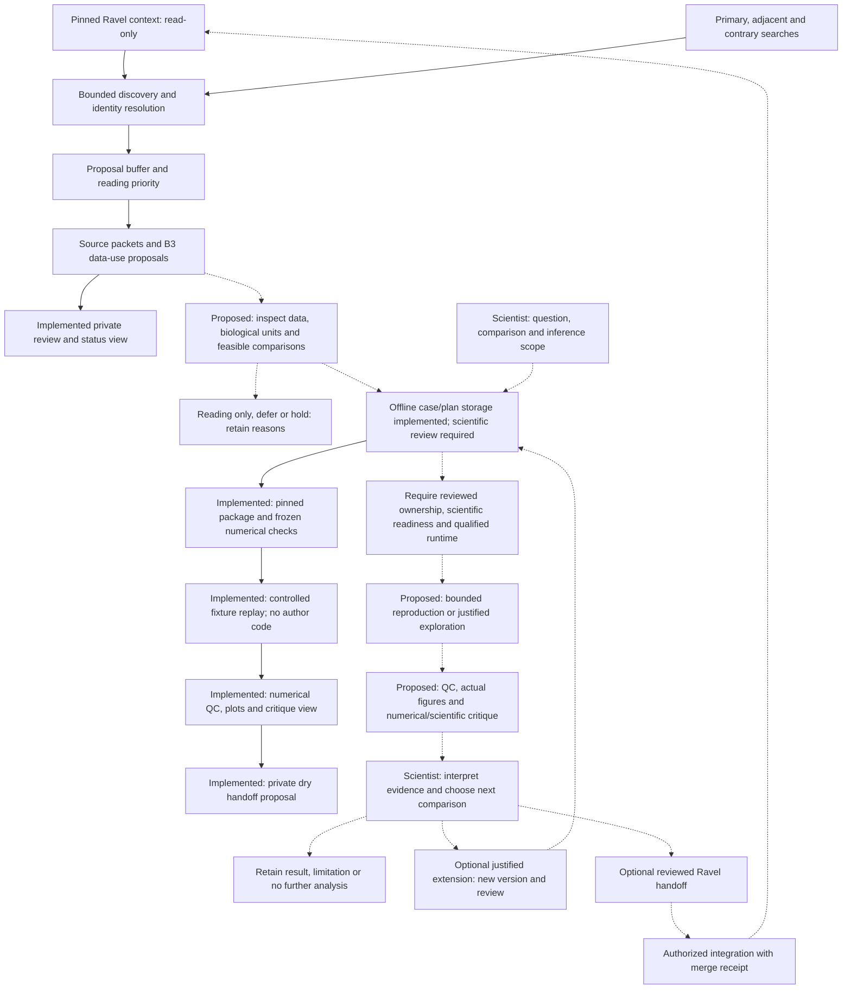
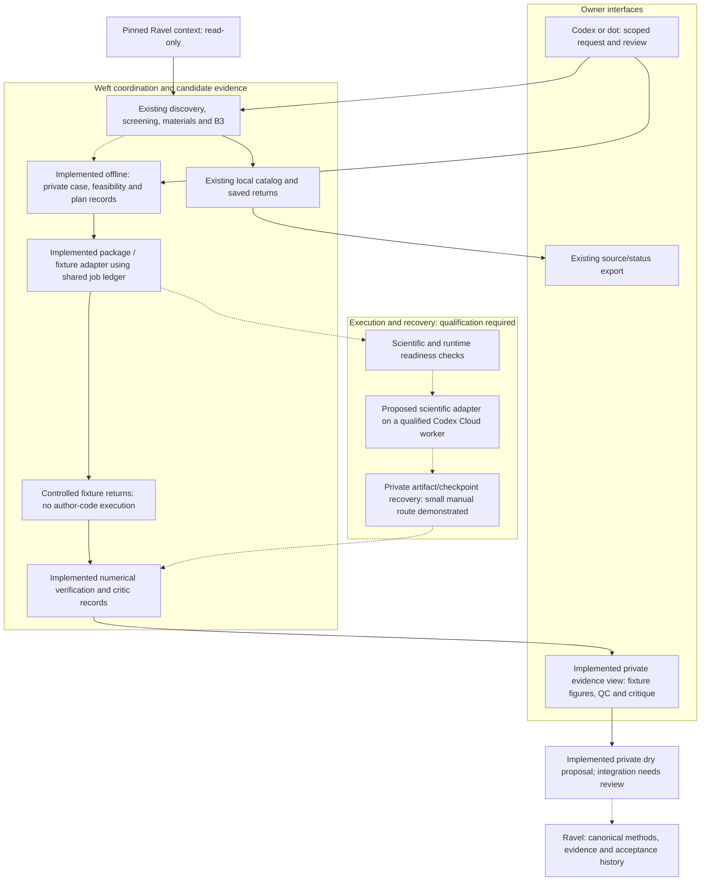

# Weft

**Agent workflows for literature discovery, reproducible reanalysis and research-question development.**

| Capability | Status | Evidence | Boundary |
|---|---|---|---|
| Offline article-local workspace, feasibility and bounded-plan records | Descriptive only | [Guide](docs/EVIDENCE_WORKSPACE.md), [validation](records/evidence-workspace-validation-20261021.json), [fixtures](tests/test_evidence.py) | Immutable byte/dependency and supplied-unit consistency checks; no scientific validity, authenticated approval, execution, recovery qualification or canonical acceptance |
| Controlled scientific package/recovery and numerical evidence review | Descriptive only | [Adapter guide](docs/SCIENTIFIC_ADAPTER.md), [validation](records/science-adapter-validation-20261021.json), [fixtures](tests/test_science_pipeline.py) | Immutable packages, fixture-only shared-ledger recovery, numerical checks/view and dry handoff; no author-code execution, scientific acceptance or remote qualification |
| Author-worker isolation evidence auditor | Descriptive only | [Unblock plan](docs/qualification/W08_RUNTIME_UNBLOCK.md), [checks](records/author-isolation-preparation-20261021.json) | Supplied Docker/probe consistency only; no execution, authenticated observation, surviving watchdog, output-quota or runtime qualification |
| Worker package/control preparation | Descriptive only | [Integration plan](docs/qualification/AUTHOR_WORKER_INTEGRATION.md), [validation](records/worker-integration-preparation-20261021.json) | Exact package inventory and supplied attempt audit binding; no live reservation, staging, dispatch or runtime qualification |
| Author preparation reservations, streaming transport and pilot mechanics | Descriptive only | [Current status](docs/IMPLEMENTATION_STATUS_20261025.md), [validation](records/technical-preparation-validation-20261025.json), [campaign](docs/qualification/AUTHOR_QUALIFICATION_CAMPAIGN.md) | Shared local slot, inert staging, quarantined returns and fixture arithmetic; no live start/termination authority, observed quota/watchdog or real pilot result |
| Provisional paper-to-analysis evidence loop | Not established | [Architecture revision and jobs](docs/EVIDENCE_GENERATION_ROADMAP.md) | Offline components implemented; real pilot, isolated worker and runtime qualification remain pending; no execution authority |
| Synthetic cloud-return intake against acknowledged intent | Descriptive only | [Guide](docs/CLOUD_RETURN_INTAKE.md), [tests](tests/test_cloud_return.py) and [validation](records/cloud-return-validation-20261020.json) | Read-only consistency checks; operator observations are not authenticated runtime evidence; no launch, resume or hold release |
| Multi-source critic/human review and inactive transfer verification | Descriptive only | [Validation](records/fulltext-review-validation-20261020.json), [guide](docs/PHASE4_FOLLOW_THROUGH.md) and [tests](tests/test_review_materials.py) | Local bytes and accounting; identity/inspection remain attested; no independent B5 qualification, cloud launch or scientific acceptance |
| Local scaffold and pinned Ravel connection checks | Descriptive only | [Validation record](records/bootstrap-validation.json) | Software checks; no scientific validation |
| Manual literature discovery and RQ review buffer | Descriptive only | [Live validation](records/discovery-validation.json) | Metadata matches and reading priority, not accepted claims |
| Bounded discovery batches and screening-agent interface | Descriptive only | [Fresh-candidate test](docs/BATCH_PILOT_20261012.md) | 74 candidates; five local link proposals; independent semantic quality evaluation remains open |
| Manual workflow coordinator and status/export view | Descriptive only | [Coordinator guide](docs/WORKFLOW_COORDINATOR.md) and [integration tests](tests/test_workflow.py) | Synthetic software tests compose discovery through B3 with saved-return recovery; no automatic cloud launch, hold release or scientific acceptance |
| Versioned paper-first nomination and bibliography audit | Descriptive only | [Selection policy and audit](docs/SELECTION_AND_MATERIAL_REVIEW.md) and [tests](tests/test_selection.py) | Synthetic software tests; transparent query-stream rotation under link caps; no demonstrated real-world relevance or population recall |
| Owner-scoped CNS biological primary-list gates | Descriptive only | [Validation record](records/primary-list-validation-20261020.json) and [policy](docs/PRIMARY_PAPER_LIST.md) | Synthetic enforcement checks; primary mechanisms require source-cited screening; prospective relevance/recall and scientific validity unqualified |
| Cached XML reuse, manifest intake and source-linked review view | Descriptive only | [Material/review guide](docs/SELECTION_AND_MATERIAL_REVIEW.md) and [tests](tests/test_materials.py) | Synthetic software tests; separate RQ assessments and opt-in private file copies; attached bytes do not establish inspection or semantic support |
| Portable screening paths and manual cloud recovery | Descriptive only | [Qualification record](records/screening-portability-20261012.json) | Five cloud link proposals; both Drive checkpoints verified; Linux-to-Windows cached recovery passed; no unattended launcher |
| B3 coverage, data-use and RQ proposals | Descriptive only | [Cloud qualification](records/b3-cloud-b4-boundary-20261012.json) | 55 targeted tests and checkpoint recovery passed; B4 source review interrupted by platform safety filtering |
| Manual source-bound reading packets | Descriptive only | [Local reader](docs/LOCAL_READER.md) | XML text/captions; semantic and figure review remain separate |
| Choi figure, supplement and input review | Descriptive only | [Review receipt](records/pilot-review-20261011.json) | Source review and file integrity; current execution status is in PROGRESS |
| Pinned Codex Cloud setup | Descriptive only | [Setup receipt](records/cloud-setup-20261011.json) | Private environment published; small export verified; no retention guarantee |
| Synthetic executor and restart recovery | Descriptive only | [Recovery receipt](records/synthetic-recovery-integration-20261011.json) | Bounded Docker restart; synthetic recovery does not prove arbitrary job recovery |
| Manual dot handoff and private checkpoints | Descriptive only | [Coordinator receipt](records/manual-coordinator-20261011.json) | Small synthetic recovery; no retention or distributed-lock guarantee |
| Manual scientific cloud execution | Descriptive only | [Metadata](records/choi-metadata-20261011.json) and [Figure1 execution](records/choi-figure1-execution-20261012.json) | Metadata and Figure1 archive verified; [scientific review](docs/PILOT_CHOI_SCIENTIFIC_REVIEW.md) complete with limits; [public outputs and recovery qualified](docs/M5_PUBLICATION_PLAN.md), bounded owner retention and Ravel integration complete |
| Autonomous paper-to-question workflow | Not established | [Marked implementation plan](docs/IMPLEMENTATION_PLAN.md#established-state) | Unattended orchestration and general fresh-paper scientific qualification remain open; bounded Choi publication is complete |

Weft is being built to bring new literature into an existing research programme:
find papers against established questions and broader reading interests, explain
their relevance, qualify reusable data, and coordinate bounded reproduction and
exploratory analysis. The intended output is a traceable evidence package,
including negative results, discrepancies and candidate questions. The current
batch coordinator executes bounded searches and supplies immutable screening
packets to the calling agent. Structured responses retain reasons and holds.
The [pull interface](docs/BATCH_SCREENING.md) has passed a fresh-candidate
development test; it does not launch models or provide unattended cloud operation.
The [manual workflow coordinator](docs/WORKFLOW_COORDINATOR.md) now connects those
components through B3, preserves interrupted work, and exports a private JSON/HTML
status view. Existing pilot catalogs remain viewable without being resumed.
New workflows use a frozen paper-first/query-stream policy, reuse verified XML
across separate RQ reviews, and accept hash-bound local material manifests. A
private review view links citations to source text and exposes material coverage.
Run `python -m weft workflow-demo --output runs/new-demo` for a reproducible
synthetic demonstration with injected transports and held scientific proposals.

The name comes from the crosswise threads of woven fabric. **Weft** is the
project name; `weft` is the repository and Python module name. It is not an acronym.

[Ravel](https://github.com/xorca0711/ravel) owns the biological questions,
scientific methods and evidence. Weft owns the automation that connects papers
and jobs to that research. Personal career interests remain in an untracked
private configuration, even though this repository is public.

The next development priority is the [evidence-generation loop and job list](docs/EVIDENCE_GENERATION_ROADMAP.md):
connect qualified papers to bounded analyses, numerical critique and scientific
follow-up. The existing coordinator stops at B3 proposals; its local executor is
fixture-only. A private article-local workspace now stores source/case records,
feasibility assessments and frozen plans without modifying Ravel. The owner
delegated implementation of this provisional ownership separation. Scientific
execution remains held at the author-code isolation and runtime qualification boundary.
The [separate adapter](docs/SCIENTIFIC_ADAPTER.md) now prepares immutable packages,
replays controlled fixtures through the shared job ledger, checks numerical
outputs and presents a private evidence view with a review-only handoff proposal.

The [W01 design baseline](docs/W01_WORKSPACE_OWNERSHIP_PROPOSAL.md) retains the
original proposal and synthetic examples. The [implemented workspace guide](docs/EVIDENCE_WORKSPACE.md)
documents actual commands, field contracts, tests and remaining blockers.

The original frozen reading evaluation remains unpassed. A new scientific pilot
must produce code, QC, figures, discrepancies and interpretation, with a separate
prospective evaluation amendment. It cannot replace independent quality evidence
with reading agreement or AI agreement. B4 remains held/excluded, Choi closed,
M6 disabled and automatic cloud launch unqualified. [Current state](PROGRESS.md)
owns exact run/merge evidence; the [existing milestone plan](docs/IMPLEMENTATION_PLAN.md)
retains historical M/B/L identifiers.

## Intended workflow

**Solid arrows show implemented manual or explicitly labelled fixture links.
Dashed arrows show scientific execution/integration still requiring qualification.**
The completed Choi case is historical evidence for its bounded route; it does not
qualify this fresh-paper loop. A reading keep starts a feasibility question, not
a scientific finding. Not every retained paper needs an analysis.



## Backend connections

The current deployment is a **checkpointed manual workflow**. The target retains
Weft's existing discovery, source, coordinator and recovery components, adding a
scientific case workspace and a separate bounded execution adapter. A case may
finish with candidate evidence in Weft; Ravel integration is an optional later
scientific decision. Provisional offline record storage is implemented; scientific
execution and acceptance remain separate, unqualified boundaries.

The diagram separates the scientific data path from runtime readiness. Existing
launch journals and the [offline cloud-return verifier](docs/CLOUD_RETURN_INTAKE.md)
check recorded intent and supplied evidence; they do not supply missing runtime
capabilities. Solid arrows show implemented manual component connections; dashed
arrows show additions or integration still requiring qualification.



The selected cloud plan remains **native dot delegation → the existing environment
→ verified private recovery**, as documented in the [remote architecture](docs/REMOTE_AUTOMATION_ARCHITECTURE.md).
The [native occurrence](docs/qualification/NATIVE_RUNTIME_HOLD.md) is held for
missing runtime-status capability and unresolved exact binding. New platform
evidence is needed; neither a new Codex project nor broader account permissions
establishes that capability. No replacement attempt or alternate service is
selected here. CLI integration is optional and scheduling remains disabled.

| Component | Current responsibility and proposed extension | Boundary |
|---|---|---|
| Weft | Discovery, source/case records, immutable packages, fixture recovery, numerical QC/view and dry proposals | No canonical RQ ownership or automatic scientific acceptance; author-code execution remains held |
| Ravel | Canonical questions, accepted scientific contracts/code, results and acceptance history | Provisional Weft records do not modify Ravel; integration remains separately authorized |
| Dot coordinator | Manual task coordination; target remote authoritative ledger | Remote writer ownership, fencing and PC-independent operation remain unqualified |
| Codex Cloud | Selected worker service; bounded historical jobs demonstrated | Fresh jobs require qualified inputs/environment; no durable archive or retry permission implied |
| Google Drive | Private verified checkpoints and evidence transfer within demonstrated bounds | Not compute, a shared database, automatic sync or immutable storage |
| GitHub Actions | Deterministic software and repository checks | Not the scientific compute backend |
| Local Codex | Development, scoped review and recovery assistance | A project/worktree choice does not repair cloud runtime capabilities |

AI-host, GitHub and Drive identities remain separate. An unknown cloud outcome
holds its attempt for reconciliation. A negative scientific result remains
reviewable evidence. Neither condition permits an automatic retry to obtain a
favorable outcome. See [job controls](docs/JOB_CONTROLS.md) for implemented bounds
and the [new jobs](docs/EVIDENCE_GENERATION_ROADMAP.md#implementation-jobs-and-completion-evidence)
for remaining work and acceptance evidence.

## Read what you need

| If you want to… | Read |
|---|---|
| Operate the batch/agent interface and inspect fresh candidates | [Batch guide](docs/BATCH_SCREENING.md) and [candidate digest](docs/BATCH_PILOT_20261012.md) |
| Run bounded searches and inspect receipts | [Discovery guide](docs/DISCOVERY.md) |
| Understand why a paper is not immediately supporting evidence | [Decision buffer](docs/DECISION_BUFFER.md) |
| See frontend/backend responsibilities and evidence destinations | [Workflow and storage map](docs/WORKFLOW_AND_STORAGE.md) |
| See the proposed paper-to-analysis architecture and implementation jobs | [Evidence-generation roadmap](docs/EVIDENCE_GENERATION_ROADMAP.md) |
| See the full development roadmap and current stage | [Implementation plan](docs/IMPLEMENTATION_PLAN.md) |
| Understand agent responsibilities and context | [Agent workflow](docs/AGENT_WORKFLOW.md) |
| Inspect automated decisions and stopping rules | [Gate specification](docs/GATES.md) |
| Connect Weft to Ravel without competing sources of truth | [Integration contract](docs/RAVEL_CONNECTION.md) |
| Inspect the original plan for the closed historical pilot | [Choi 2020 pilot](docs/PILOT_CHOI_2020.md) |
| Inspect completed figures, supplements and dataset qualification | [Choi review](docs/PILOT_CHOI_REVIEW.md) |
| Review the completed bounded Choi publication and its limits | [M5 publication plan](docs/M5_PUBLICATION_PLAN.md) |
| Configure the selected cloud environment and access | [Cloud setup runbook](docs/CLOUD_SETUP.md) |
| Qualify the scientific runtime | [Execution environment](docs/EXECUTION_ENVIRONMENT.md) |
| Evaluate missed papers, extraction and analysis fidelity | [Evaluation plan](docs/EVALUATION.md) |
| Check completed work and remaining dependencies | [Current state](PROGRESS.md) |
| See authorship, decisions and revisions | [Development record](DEVELOPMENT.md) |

## Try it yourself

Python 3.12+ and Git are sufficient. No API key, datasets or scientific packages
are needed for validation or manual metadata searches:

```bash
git clone https://github.com/xorca0711/weft.git
cd weft
python -m weft validate
python -m unittest discover -s tests -q
```

To verify the Ravel pin and referenced Git objects, use an existing clone that
contains the revision in [ravel.lock.json](integration/ravel.lock.json):

```bash
python -m weft verify-ravel --repo /path/to/ravel
```

Use the [batch commands](docs/BATCH_SCREENING.md) for coordinated searches and
structured screening, or the lower-level [discovery commands](docs/DISCOVERY.md)
and [manual reader](docs/LOCAL_READER.md) for individual operations.

The verifier reads **committed blobs at the pinned revision**, so local edits are
neither consumed nor overwritten. It does not run historical analysis scripts,
download datasets, connect an AI account, or write to Ravel.

## Execution and scientific boundaries

The owner selected a dot to coordinate and Codex Cloud to execute versioned code,
starting with manually dispatched qualification. No additional local PC is required.
The [roadmap](docs/IMPLEMENTATION_PLAN.md) puts job limits, state recovery and artifact
export before the numerical pilot. GitHub CI remains for deterministic tests.
Cloud selection does not establish available RAM, runtime limits or scientific readiness.

The first paper is a deliberately exposed historical benchmark, **Choi et al.,
Cell Stem Cell (2020)**. Its bounded completion tested workflow fidelity and correct
holds; it did not establish new biology or performance on unseen papers. Fresh-paper
evaluation follows separately. A candidate question is not scientific acceptance.

No scheduled searches, paid API calls, scientific runs, automatic merges or
GitHub-to-local execution are enabled by cloning this repository.
