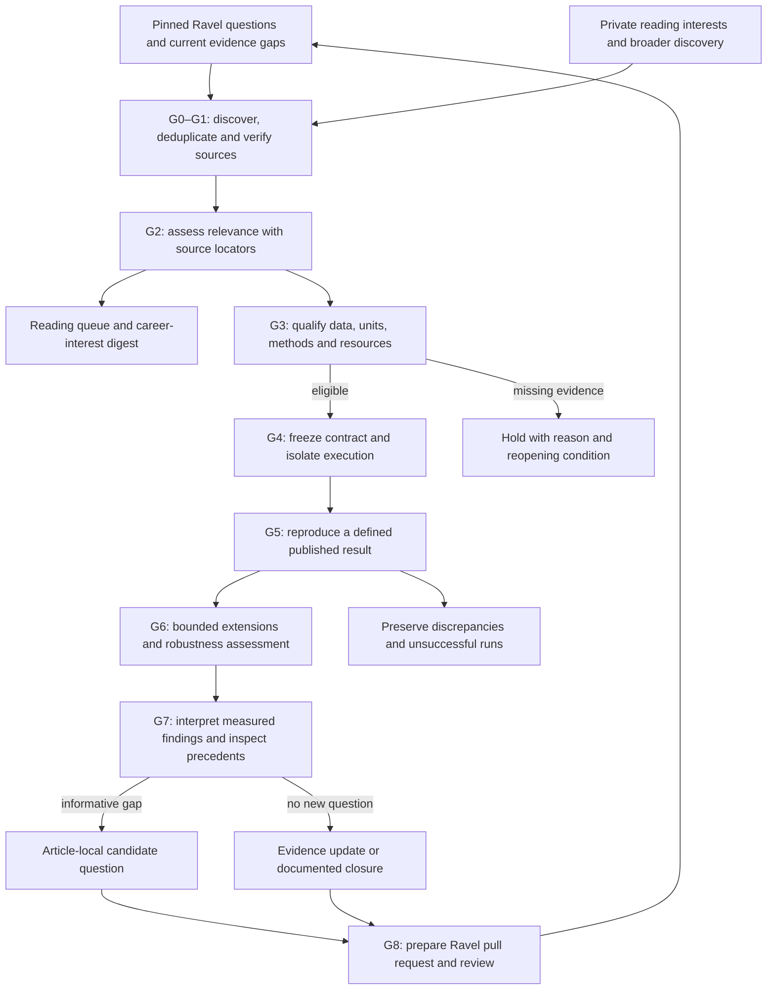

# Weft

**Agent workflows for literature discovery, reproducible reanalysis and research-question development.**

| Capability | Status | Evidence | Boundary |
|---|---|---|---|
| Local scaffold and pinned Ravel connection checks | Descriptive only | [Validation record](records/bootstrap-validation.json) | Software checks; no scientific validation |
| Autonomous paper-to-question workflow | Not established | [Implementation plan](docs/IMPLEMENTATION_PLAN.md) | Planned; discovery, agent execution and scientific runs are not enabled |

Weft is being built to bring new literature into an existing research programme:
find papers against established questions and broader reading interests, explain
their relevance, qualify reusable data, and coordinate bounded reproduction and
exploratory analysis. The intended output is a traceable evidence package,
including negative results, discrepancies and candidate questions.

The name comes from the crosswise threads of woven fabric. **Weft** is the
project name; `weft` is the repository and Python module name. It is not an acronym.

[Ravel](https://github.com/xorca0711/ravel) owns the biological questions,
scientific methods and evidence. Weft owns the automation that connects papers
and jobs to that research. Personal career interests remain in an untracked
private configuration, even though this repository is public.

## Intended workflow

This diagram describes the target system. Only the configuration, documentation
and read-only Ravel connection verifier are implemented in this initial version.



## Read what you need

| If you want to… | Read |
|---|---|
| Build the system in concrete stages | [Implementation plan](docs/IMPLEMENTATION_PLAN.md) |
| Understand agent responsibilities and context | [Agent workflow](docs/AGENT_WORKFLOW.md) |
| Inspect automated decisions and stopping rules | [Gate specification](docs/GATES.md) |
| Connect Weft to Ravel without competing sources of truth | [Integration contract](docs/RAVEL_CONNECTION.md) |
| Run the first complete paper pilot after implementation | [Choi 2020 pilot](docs/PILOT_CHOI_2020.md) |
| Evaluate missed papers, extraction and analysis fidelity | [Evaluation plan](docs/EVALUATION.md) |
| Check completed work and remaining dependencies | [Current state](PROGRESS.md) |
| See authorship, decisions and revisions | [Development record](DEVELOPMENT.md) |

## Try it yourself

Python 3.12+ and Git are sufficient. No API key, datasets or scientific packages
are needed for these checks:

```bash
git clone https://github.com/xorca0711/weft.git
cd weft
python -m weft validate
python -m unittest discover -s tests -q
```

To verify the Ravel pin and referenced Git objects, use an existing clone that
contains the revision in [ravel.lock.json](integration/ravel.lock.json):

```bash
python -m weft verify-ravel --repo /path/to/ravel
```

The verifier reads **committed blobs at the pinned revision**, so local edits are
neither consumed nor overwritten. It does not run historical analysis scripts,
download datasets, connect an AI account, or write to Ravel.

## Execution and scientific boundaries

Future routine work can run under a standing scope and resource policy. GitHub
can coordinate discovery and validation; substantial analyses belong on isolated
workers with persistent data storage. Dots or another agent backend can invoke
the same tools. No dependency on a particular chat session is intended.

The first paper is a deliberately exposed historical benchmark, **Choi et al.,
Cell Stem Cell (2020)**. Completing it would test workflow fidelity and correct
holds, not establish new biology or performance on unseen papers. Fresh-paper
evaluation follows separately. A candidate question is not scientific acceptance.

No scheduled searches, paid API calls, scientific runs, automatic merges or
GitHub-to-local execution are enabled by cloning this repository.
