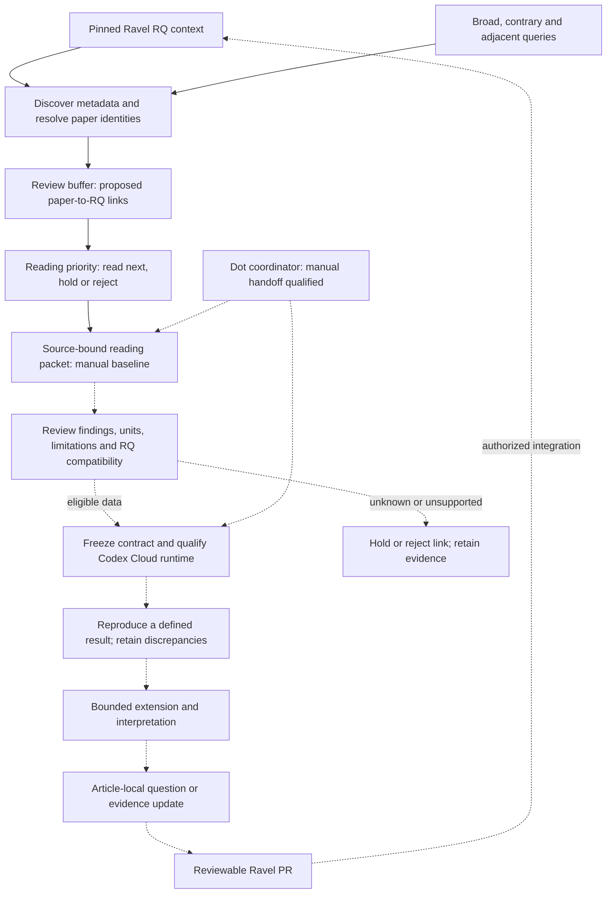
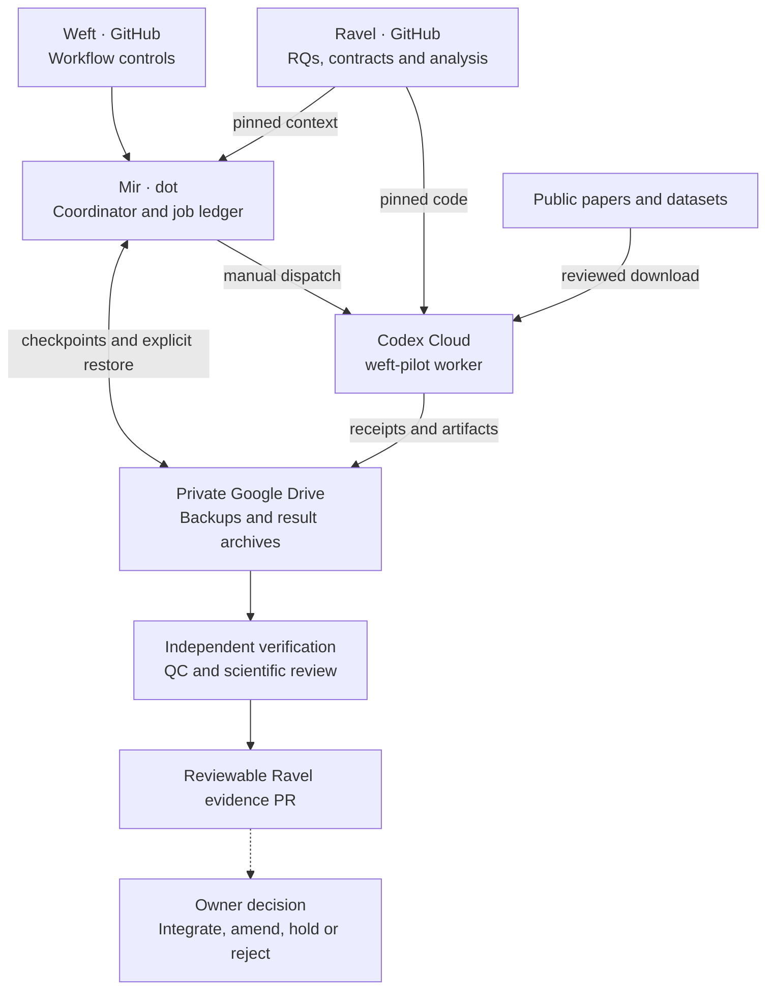

# Weft

**Agent workflows for literature discovery, reproducible reanalysis and research-question development.**

| Capability | Status | Evidence | Boundary |
|---|---|---|---|
| Local scaffold and pinned Ravel connection checks | Descriptive only | [Validation record](records/bootstrap-validation.json) | Software checks; no scientific validation |
| Manual literature discovery and RQ review buffer | Descriptive only | [Live validation](records/discovery-validation.json) | Metadata matches and reading priority, not accepted claims |
| Manual source-bound reading packets | Descriptive only | [Local reader](docs/LOCAL_READER.md) | XML text/captions; semantic and figure review remain separate |
| Choi figure, supplement and input review | Descriptive only | [Review receipt](records/pilot-review-20261011.json) | Source review and file integrity; current execution status is in PROGRESS |
| Pinned Codex Cloud setup | Descriptive only | [Setup receipt](records/cloud-setup-20261011.json) | Private environment published; small export verified; no retention guarantee |
| Synthetic executor and restart recovery | Descriptive only | [Recovery receipt](records/synthetic-recovery-integration-20261011.json) | Bounded Docker restart; synthetic recovery does not prove arbitrary job recovery |
| Manual dot handoff and private checkpoints | Descriptive only | [Coordinator receipt](records/manual-coordinator-20261011.json) | Small synthetic recovery; no retention or distributed-lock guarantee |
| Manual scientific cloud execution | Descriptive only | [Metadata](records/choi-metadata-20261011.json) and [Figure1 execution](records/choi-figure1-execution-20261012.json) | Metadata and Figure1 archive verified; [scientific review](docs/PILOT_CHOI_SCIENTIFIC_REVIEW.md) complete with limits; publication pending |
| Autonomous paper-to-question workflow | Not established | [Implementation plan](docs/IMPLEMENTATION_PLAN.md) | Scientific workers, unattended agents and Ravel export remain planned |

Weft is being built to bring new literature into an existing research programme:
find papers against established questions and broader reading interests, explain
their relevance, qualify reusable data, and coordinate bounded reproduction and
exploratory analysis. The intended output is a traceable evidence package,
including negative results, discrepancies and candidate questions.

The name comes from the crosswise threads of woven fabric. **Weft** is the
project name; `weft` is the repository and Python module name. It is not an acronym.

[Ravel](https://github.com/xorca0711/ravel) owns the biological questions,
scientific methods and evidence. Weft owns the automation that connects papers
and jobs to that research. Personal career interests remain in an untracked
private configuration, even though this repository is public.

## Intended workflow

The selected deployment uses a dot for coordination and Codex Cloud for execution.
The cloud environment is published. Metadata is verified; the first descriptive
Figure1 archive and scientific review are complete with documented limits; publication remains open. Solid arrows show
implemented discovery/reading stages; dotted arrows show scientific links still
being qualified end to end. An RQ supplies search context; the review buffer keeps proposed
relationships separate from accepted evidence.



## Backend connections

The current deployment is a **checkpointed manual workflow**. Weft and Ravel are
GitHub repositories; Mir is the dot coordinator; Codex Cloud supplies temporary
execution workspaces; private Google Drive stores recovery checkpoints and result
archives. There is no separate Google Cloud Platform project, VM or storage bucket.



The arrows describe the selected route, including steps that remain under
qualification; they do not represent an unattended pipeline. Metadata recovery
has passed independent readback. The first Figure1 analysis has executed once;
its archive and [scientific review](docs/PILOT_CHOI_SCIENTIFIC_REVIEW.md) are complete
with documented limits; complete-output publication and human review remain open. See
[current state](PROGRESS.md) for the latest hold and its evidence.

| Component | Responsibility | What it does not provide |
|---|---|---|
| Weft | Discovery, proposed paper-to-RQ links, job controls and run records | Canonical RQ ownership or automatic scientific acceptance |
| Ravel | Scientific questions, frozen methods, results and acceptance history | A cloud compute service |
| Mir | One coordinator and one authoritative ledger | Guaranteed workspace retention or distributed locking |
| Codex Cloud | Execute a bounded, pinned job and preserve its receipt | Durable archival storage or permission to rerun an uncertain attempt |
| Google Drive | Private, hash-verified backups and evidence transfer | Compute, automatic synchronization or immutable storage |
| GitHub Actions | Deterministic software and repository checks | The scientific compute backend |
| Local Codex | Operator review, documentation and recovery assistance | A required always-on execution machine |

AI-host sign-in, GitHub identity and Google Drive identity are separate. Verify
the authorized identity for each service before writes. A cloud usage interruption
holds the existing attempt for reconciliation; it is not an analysis failure or
permission for a new run. The [manual pilot protocol](docs/MANUAL_PILOT.md) defines
checkpoint and recovery steps; [job controls](docs/JOB_CONTROLS.md) distinguish
implemented safeguards from remaining qualification work.

## Read what you need

| If you want to… | Read |
|---|---|
| Run bounded searches and inspect receipts | [Discovery guide](docs/DISCOVERY.md) |
| Understand why a paper is not immediately supporting evidence | [Decision buffer](docs/DECISION_BUFFER.md) |
| See the full development roadmap and current stage | [Implementation plan](docs/IMPLEMENTATION_PLAN.md) |
| Understand agent responsibilities and context | [Agent workflow](docs/AGENT_WORKFLOW.md) |
| Inspect automated decisions and stopping rules | [Gate specification](docs/GATES.md) |
| Connect Weft to Ravel without competing sources of truth | [Integration contract](docs/RAVEL_CONNECTION.md) |
| Run the first complete paper pilot after implementation | [Choi 2020 pilot](docs/PILOT_CHOI_2020.md) |
| Inspect completed figures, supplements and dataset qualification | [Choi review](docs/PILOT_CHOI_REVIEW.md) |
| Configure the selected cloud environment and access | [Cloud setup runbook](docs/CLOUD_SETUP.md) |
| Qualify the scientific runtime | [Execution environment](docs/EXECUTION_ENVIRONMENT.md) |
| Evaluate missed papers, extraction and analysis fidelity | [Evaluation plan](docs/EVALUATION.md) |
| Check completed work and remaining dependencies | [Current state](PROGRESS.md) |
| See authorship, decisions and revisions | [Development record](DEVELOPMENT.md) |

## Try it yourself

Python 3.12+ and Git are sufficient. No API key, datasets or scientific packages
are needed for validation or manual metadata searches:

```bash
git clone https://github.com/xorca0711/weft.git
cd weft
python -m weft validate
python -m unittest discover -s tests -q
```

To verify the Ravel pin and referenced Git objects, use an existing clone that
contains the revision in [ravel.lock.json](integration/ravel.lock.json):

```bash
python -m weft verify-ravel --repo /path/to/ravel
```

Use the [discovery commands](docs/DISCOVERY.md) to search and inspect the buffer,
then the [manual reader](docs/LOCAL_READER.md) to prepare an eligible paper.

The verifier reads **committed blobs at the pinned revision**, so local edits are
neither consumed nor overwritten. It does not run historical analysis scripts,
download datasets, connect an AI account, or write to Ravel.

## Execution and scientific boundaries

The owner selected a dot to coordinate and Codex Cloud to execute versioned code,
starting with manually dispatched qualification. No additional local PC is required.
The [roadmap](docs/IMPLEMENTATION_PLAN.md) puts job limits, state recovery and artifact
export before the numerical pilot. GitHub CI remains for deterministic tests.
Cloud selection does not establish available RAM, runtime limits or scientific readiness.

The first paper is a deliberately exposed historical benchmark, **Choi et al.,
Cell Stem Cell (2020)**. Completing it would test workflow fidelity and correct
holds, not establish new biology or performance on unseen papers. Fresh-paper
evaluation follows separately. A candidate question is not scientific acceptance.

No scheduled searches, paid API calls, scientific runs, automatic merges or
GitHub-to-local execution are enabled by cloning this repository.
