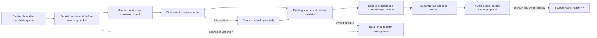

# Screening handoff and intake staging

This is an offline-tested extension of B1/B2 and B3, not an unattended deployment.
It uses the existing discovery catalog, candidate packets and source validators.
It neither runs a model nor touches the Choi ledger. [Current evidence](../records/backend-handoff-20261012.json).

## Single-catalog handoff



Example commands use an already created synthetic/development catalog and batch.
They are not instructions to resume B4 or Choi. Output packets, responses and
catalogs are private; store them in ignored `runs/` paths.

```powershell
python -m weft handoff-init --store runs/example
python -m weft handoff-claim --store runs/example --batch BATCH_ID --actor screening-agent --lease-seconds 1800
python -m weft handoff-status --store runs/example
python -m weft handoff-submit --store runs/example --claim CLAIM_ID --assessment runs/response.json
python -m weft handoff-recover --store runs/example --claim CLAIM_ID
```

- The OS lock serializes wrapper calls. One unfinished handoff blocks another
  claim across every batch in that catalog. The database commits the packet
  association before returning it; `handoff-packet --claim CLAIM_ID` recovers
  lost command output, without authorizing another worker.
- A 60–3600 second lease bounds acceptance of a new response. Expiry never
  requeues a candidate, launches another agent or releases an uncertain job.
  There is deliberately no force-unlock, retry/new-attempt or silent rebind command.
- Submission must match the saved batch, candidate, packet and actor label.
  The label is an attestation, not authenticated identity. Exact response bytes
  are saved before calling the existing screening validator.
- Recovery retries only ingestion of that saved response, including after an
  acknowledgement was lost. The existing live-source and exact-replay checks
  still apply. A changed or invalid response stays held for explicit review;
  it cannot be swapped for a second response through this wrapper.
- Host/path binding refuses accidental activation of a restored catalog at a
  different location. This is **not distributed fencing**: a same-path restore,
  cloned host or direct database edit is not excluded. Historical `batch-*`
  commands also remain available and do not enforce wrapper claims. Use one
  cooperative operator and no parallel lower-level mutators. A durable production
  queue requires a separately qualified owner/lease service and restore protocol.
- No model cost meter, process-kill watchdog, worker credential, scheduler or
  cloud retention guarantee is introduced here. A lease is not a process timeout.

## Private intake preparation

```powershell
python -m weft intake-prepare --store runs/example --batch BATCH_ID --candidate CANDIDATE_ID --scope data_review
python -m weft intake-verify --store runs/example --batch BATCH_ID --candidate CANDIDATE_ID --scope data_review --directory RETURNED_DIRECTORY --manifest-sha256 RETURNED_SHA256
```

Choose `data_review` or `rq_review` explicitly. The selected B3 proposal must be
current and `review_required`, with no unresolved coverage holds. That status
means ready for a decision; it does **not** mean data-use approval or accepted
RQ support. A data proposal can be staged while the RQ proposal remains held;
the summary carries both statuses and every remaining hold.

The tool creates a new directory under
`STORE/intake-staging/REVIEW_SHA256/SCOPE/`, never overwriting an existing one.
It contains exactly `review.json`, `summary.json`, `provenance.json`, `README.md`
and `manifest.json`. Verification checks the externally retained manifest hash,
exact members/bytes and the current source/review. Superseded or changed evidence
invalidates current verification while preserving the old files.

No full text, figures, supplements, datasets, database or recovery records are
automatically copied. Reviewer free text can still contain private or copyrighted
material, so **the proposal is private and not privacy-cleared**. Publication
review and a scoped Ravel PR remain separate. Its proposed destination under
`weft_intake/` is documentary, not an instruction or permission to write there.
The existing Choi intake is unchanged.

## Verification and next boundary

Synthetic tests cover duplicate claims, lock contention, lost output, two crash
points, exact replay, expiry, invalid/stale evidence, changed source/response,
restored-copy refusal and intake tampering/supersession. They do not evaluate
paper judgments. The [launcher qualification note](LAUNCHER_QUALIFICATION.md)
and [B5 preparation](B5_EVALUATION_PREPARATION.md) define the next decisions.
