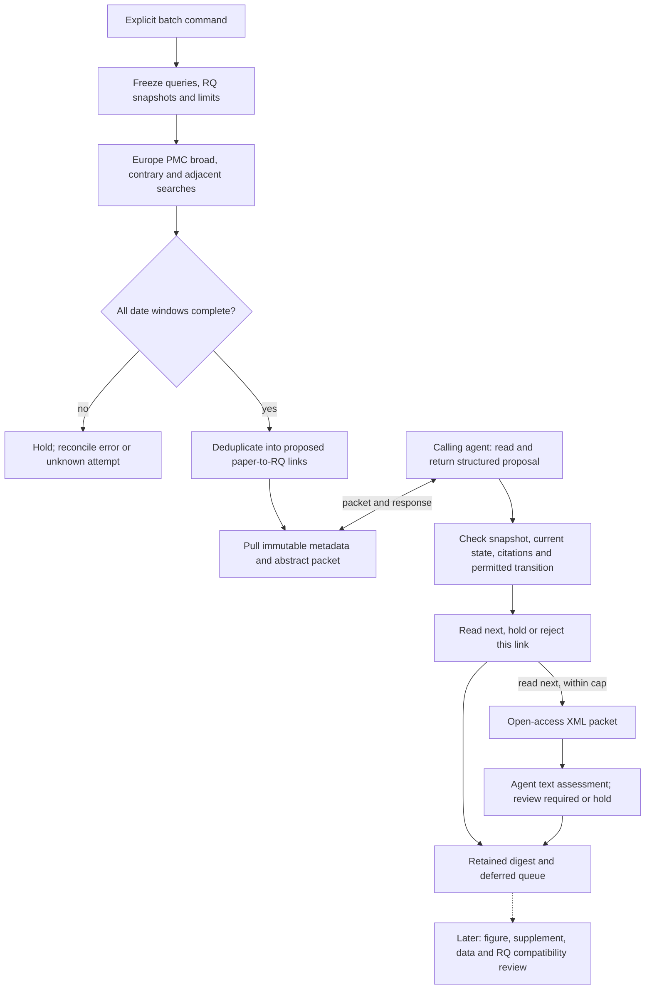

# Bounded discovery and screening interface

Implemented for an explicit operator trigger and an agent that pulls packets.
The coordinator runs the searches and records the queue; the calling agent reads
and submits proposals. It does not launch a model or create a cloud task. This
interface can be driven by a qualified cloud agent, but that deployment and its
durable recovery are not yet qualified. No extra local PC is required by the
selected dot/Codex Cloud design.

## Where candidates come from

The current adapter searches the [Europe PMC API](https://europepmc.org/RestfulWebService).
It aggregates bibliographic records, abstracts and available open-access text,
including PubMed records. It is not a Cell/Nature/Science website scraper. See
[EMBL-EBI's search overview](https://www.ebi.ac.uk/training/online/courses/europepmc-quick-tour/searching-and-visualising-data/).
PubMed is primarily the citation/abstract index; PMC is the full-text archive
([NLM explanation](https://support.nlm.nih.gov/knowledgebase/article/KA-03247/en-us)).
Publisher pages remain sources for authoritative article versions, figures,
corrections and supplements when accessible. Dataset repositories such as GEO
belong to the later eligibility stage, not the discovery index itself.

Index presence does not establish peer review or merit. The candidate list retains
publication types, dates and source identities; preprints and reviews can occur.
Cell/Nature/Science can be prioritized in a later reviewed ranking, but the batch
requires a broad stream and does not use journal prestige as an eligibility gate.
The current FIRST_IDATE window selects newly indexed records, which need not be
newly published articles. A0/A1 query coverage does not cover all 32 Ravel RQs.

## Implemented sequence



Reading priority is a proposal. Hashes verify evidence identity and locator
existence, not whether the cited passage entails the agent's reason. Actor names
are recorded, not authenticated by this interface. Source text is untrusted;
strict response fields reject execution grants, but do not certify that a model
resists every prompt injection. No transition writes Ravel, accepts a claim,
opens a scientific job or releases Choi's reservation.

## Commands

Use a reviewed profile and a Ravel clone containing the pinned blobs. Store raw
responses, full text and state only in ignored `runs/` (or private cloud storage).

```bash
python -m weft batch-discover --repo /path/to/ravel --profile alveolar-transitions \
  --since 2026-09-12 --until 2026-10-12 --max-searches 12 --max-records 100 \
  --max-screenings 5 --max-full-reads 2 --store runs/my-batch
python -m weft batch-status --batch BATCH_ID --store runs/my-batch
python -m weft batch-next --batch BATCH_ID --store runs/my-batch > runs/my-batch/packet.json
python -m weft batch-submit --batch BATCH_ID --store runs/my-batch --assessment runs/my-batch/response.json
python -m weft batch-read --batch BATCH_ID --store runs/my-batch --candidate CANDIDATE_ID
python -m weft batch-submit-reading --batch BATCH_ID --store runs/my-batch --assessment runs/my-batch/reading.json
python -m weft batch-digest --batch BATCH_ID --store runs/my-batch
```

The example dates are historical; choose an explicit current window for a new
batch. Put packet/response files inside the private run directory in real use.
`batch-next` returns instructions, a source packet and an exact response template.
Fill the template from inspected evidence, record exposure and limitations, cite
locators/hashes, and retain a reopening condition for hold/reject. Repeat next /
submit until no packet remains. Use `batch-status --include-items` for the entire
queue. `screening_complete` means the bounded queue has reached a disposition;
deferred links have **not** been assessed. Reading assessments may remain held.

Maximums are search attempts (including retries after reconciliation), records
per search, screened **paper/RQ links**, and attempted XML reads (including failed
reads). These are enforced by the batch specification. HTTP transport retries
also have the adapter's existing bound. There is no measured model-token or
dollar budget and no autonomous model service. The five-link development sample
uses lexical paper ID then RQ ID, deliberately not a claimed relevance ranking.

## Restart and evidence rules

- Identical specs share a batch ID. Completed searches and identical submissions
  are not repeated. A pending agent packet is returned unchanged on restart.
  An overlapping batch retains an existing disposition and holds for explicit
  versioned reopening instead of replacing the review.
- Truncated multi-day windows split into inclusive, non-overlapping halves within
  the attempt cap. A truncated single day, exhausted budget or incomplete stream
  holds screening; absence of hits is recorded as a completed empty search.
- `batch-resume` processes pending windows only. A crash leaves a running/unknown
  attempt. Inspect it, then use `batch-reconcile --window ID --reason TEXT` before
  resuming an error/unstable/unknown window. The original attempts remain counted.
- OS advisory locks serialize batch callers on one filesystem and release on
  process exit. SQLite transactions protect response ingestion. These are not
  distributed leases. Legacy discovery/review commands are separate entry points;
  use one coordinator and recheck current candidate state at transitions.
- Metadata older than seven days, changed snapshots, altered source artifacts,
  external reviews and conflicting responses block dependent transitions. Refresh
  through a new explicit batch/specification; preserve prior packets and decisions.
- XML attempts are reserved before network IO. Unknown or failed reads remain
  held and are not automatically replayed. Different assessments cannot overwrite
  an existing response. Versioned amendments/reopening are not implemented yet.
- All metadata stages use the existing discovery `catalog.sqlite`; none mutate
  the scientific job ledger. Digests are private exports by default. Review before
  publishing: the raw store includes full text, abstracts and local paths.

The [live development record](BATCH_PILOT_20261012.md) verifies local byte and
read-only SQLite restoration. It does **not** qualify a resumed cloud writer.
Existing XML receipts cache absolute local directories; moving a store between
hosts requires an explicit path-reconciliation adapter before continued reading.
Cloud handoff, authoritative checkpoint placement and recovery must be qualified
before deployment. Do not copy the Choi ledger into this development store.
