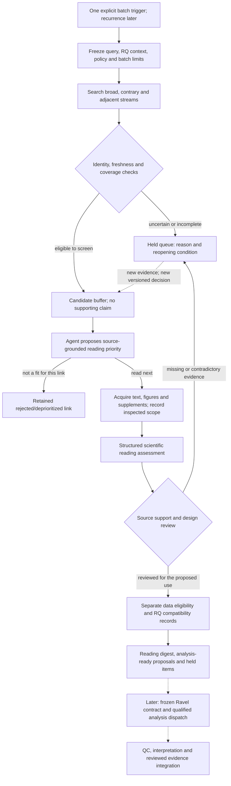

# Discovery and screening backend: next implementation sequence

**12 October 2026: B1/B2 mechanics and manual cloud recovery are qualified.
B3 software controls passed cloud qualification; actual material/semantic review
remains partial. B4 is blocked by platform safety filtering. B5 independent
evaluation and unattended operation are planned.**
See the [command guide](BATCH_SCREENING.md) and [fresh-candidate development test](BATCH_PILOT_20261012.md).
Prioritize discovery-to-screening orchestration before the remaining Choi
publication closeout. The existing Choi attempt is a completed, exposed test of
manual compute, recovery and interpretation. Its merge is not a prerequisite for
building or evaluating candidate screening. Publication/recovery is now qualified;
preserve its held reservation and original evidence until review/coordination is
reconciled. Do not rerun it.

## Current B1-B5 status

| Slice | Status | Verified progress | Remaining / blocker |
|---|---|---|---|
| B1 batch coordinator | **Qualified — bounded mechanics** | Three cloud searches: 82 observations, 74 papers, 148 proposed RQ links; replay/limits/recovery passed | Broader retrieval-quality evaluation belongs to B5; no autonomous trigger |
| B2 screening interface | **Qualified — manual handoff** | Five source-bound link proposals, one held XML assessment, before/after Drive verification and cross-host recovery | 143 links deferred; no independent decision-accuracy claim or unattended launcher |
| B3 evidence and dataset qualification | **Partial — software qualified** | Source coverage/attachments, separate versioned data-use and RQ proposals; 55 targeted cloud tests and new-worker checkpoint restore passed | Actual figure/supplement coverage and proposed-use dataset/design review incomplete; holds remain |
| B4 bounded screening batch | **Blocked — incomplete** | Manual search-to-screening path and checkpoint recovery demonstrated; source acquisition began | Platform safety rejection; preservation-only follow-up also rejected. Final transfer/store state unverified; no completed source-review digest or new after-review recovery |
| B5 evaluation and recurrence | **Planned** | Evaluation requirements specified | Freeze independent unseen/contrary/low-ranked paper set; measure errors and missed papers; qualify launcher/recovery/usage controls before any cadence decision |

Evidence: [manual cloud qualification](SCREENING_CLOUD_QUALIFICATION.md),
[B3/B4 receipts and interruption](B3_CLOUD_B4_REVIEW.md). These are operational
statuses, not scientific acceptance. [Overall roadmap](IMPLEMENTATION_PLAN.md#established-state)
separates this priority track from Choi M5 publication. PRs #4-#8 are merged into
main with passing post-merge CI at every step; see [integration status](PR_STACK_INTEGRATION.md).
The separate [M5 output package](M5_PUBLICATION_PLAN.md) is now publicly
published with owner approval, independently recovered and qualified in clean CI.
The owner retained the descriptive benchmark; Ravel #149 is merged with passing main CI.

## What exists and what does not

| Component | Current implementation | Missing qualification or implementation |
|---|---|---|
| Ravel context | `weft/context.py`; all 32 pinned question identities | Query profiles initially cover A0/A1, not every RQ; dossier contents need source-specific reading |
| Discovery | `weft/europe_pmc.py`, `weft/discovery.py`; explicit bounded searches, cursors, overlap windows and receipts | Batch coordination and bounded date splitting now implemented; broader recall evaluation and recurrence remain open |
| Identity and deduplication | `weft/identity.py`; strong IDs, conflicts, changed-snapshot invalidation | Complete edition/correction-family reconciliation; dataset lineage is a separate relation |
| Candidate buffer | Persistent proposed links; `pending_review -> read_next / held / rejected` | Pull-based structured agent proposals now implemented; independent decision-quality evaluation remains open |
| Reading | `weft/reading.py`; open-access XML packets and assessment hash/locator checks | Manual cloud screening handoff qualified; figure/supplement coverage and independent screening evaluation remain open |
| Scientific eligibility | G3-G8 specification and Ravel's existing runner/governance | Weft does not implement the semantic scientific gate engine or its full transitions |
| Job controls | `jobs.py`, `executor.py`, `checkpoints.py`, `recovery.py`, `transfer_parts.py`; tested synthetic execution and manual cloud recovery | Connect discovery/reading jobs to one authoritative durable queue and supported agent handoff |
| Live operation | Manually launched agent/cloud tasks | No unattended launcher, paid model API or recurring schedule configured |

The [single-catalog handoff wrapper](BACKEND_HANDOFF.md) now adds synthetic-tested
claim/return/recovery controls and private B3 intake staging. It does not join the
Choi ledger or provide distributed fencing. [Launcher qualification](LAUNCHER_QUALIFICATION.md)
has reached a successful read-only CLI listing, with intended environment and
PC-off invocation still unverified. [Independent evaluation](B5_EVALUATION_PREPARATION.md)
is prepared as a plan, not completed evidence.

Existing tests establish bounded software behavior, not that the system finds
all relevant papers or correctly judges scientific support. `validate-reading`
checks source identities and locator existence; it does not establish entailment.

## Three distinct decisions

Avoid a single paper-quality score or permanent paper-wide accept/reject label.
Decisions concern a stage, proposed use or paper-to-RQ link; the same paper can
have several different dispositions.

| Decision | Required reasoning | Permitted outcome |
|---|---|---|
| Worth reading? | Specific question/adjacent methodological insight, evidence inspected, contrary findings and access scope | Read next, hold for missing information, or deprioritize/reject this link with a reason |
| Suitable for a defined analysis? | Actual dataset files, biological units, conditions, measured endpoint, availability and compute fit | Eligible for bounded description or another identified work type; hold; or unsuitable for that proposed analysis |
| Does a finding connect to Ravel? | Current RQ evidence/amendments plus population, comparison, timing, endpoint, units and shared-source lineage | Proposed direct, contrary, adjacent, methodological or unsupported relationship; no accepted claim |

A useful paper without downloadable data can stay on the reading list. A strong
contrary result is not irrelevant because it disagrees with an RQ. No independent
animals can block a replicated-effect analysis while still permitting description.
Prestige affects optional reading order, never eligibility or truth. Personal
career interests remain private and separately justified; an unconfigured career
profile is unknown, not an inferred preference. Rejected links remain auditable.

## Backend flow to implement

Arrows describe the target design, not completed qualification. Batch commands
now compose discovery, packet/response ingestion and bounded XML reading. Figure,
supplement coverage, data-use and RQ-compatibility records now have a
[B3 interface](EVIDENCE_QUALIFICATION.md). Automated acquisition, actual material
inspection and semantic scientific admission remain separate. A model proposes
reasons and cited findings. Deterministic controls
reject missing, changed, stale or unauthorized records. Scientific support requires
evaluation beyond valid JSON or a confidence score.

## Concrete implementation order

These slices refine M1/M2/M3; they do not renumber the roadmap or retroactively
change scientific authority. New gate semantics require explicit code review.

| Slice | Deliverable | Acceptance evidence |
|---|---|---|
| B1: batch coordinator | Bounded discovery command composing existing adapters; per-stage job keys, queue/events, receipts, explicit hold/resume and safe window partitioning | No duplicate candidate/job on replay; cutoff never advances over gaps or failed retrieval; crash/restart preserves prior decisions; stale context invalidates dependent work |
| B2: screening worker contract | Immutable input packet, source-bound priority/assessment schema, supported cloud-agent handoff and result ingestion | Missing/fabricated locator, stale metadata, prompt-injection instructions, wrong paper/RQ and malformed responses cannot authorize the next stage; agent failures preserve resumable holds |
| B3: evidence and dataset qualification | Figure/supplement coverage records; separate data-eligibility and RQ-compatibility records; cohort/accession lineage | Distinguish captions from inspected images; pooled units, absent controls, inaccessible files, incompatible endpoints and shared datasets constrain the proposed use correctly |
| B4: bounded screening batch | One initial trigger; agent processes a small fresh candidate queue and returns a digest with read/hold/link-reject reasons | Preserve every candidate and attempt; source-supported rationale; readable digest; all state/evidence exported and independently restorable; no biological analysis or Ravel write |
| B5: qualification and recurrence | Independently reviewed fresh-paper set, missed-paper audit, decision disagreement/error measures, supported recurring trigger and observable resource controls | Review low-ranked/rejected and contrary papers as well as successes; freeze evaluation criteria before the live batch; authorize cadence only after technical and quality checks |

Suggested implementation locations are new `weft/batches.py` and
`weft/screening.py`, with focused tests and versioned schemas/configuration.
Both files now extend the existing discovery catalog, independently of the held
scientific job ledger. Reuse existing scientific controls at the future dispatch
boundary; do not create a competing scientific authority. Reading/data fields must retain
unknowns, actor attribution, inspected scope and exact source/context hashes.

The first B4 batch should use freshly discovered candidates whose answers are
not taken from existing completed Ravel analyses. Record all prior exposure;
do not claim a blinded evaluation merely because the code runs in another task.
Use Choi as a regression/failure-case fixture, including the pooled-library and
absent-state cases. No new numerical paper reproduction is needed to test this
front end. Expand query profiles beyond A0/A1 through reviewed registry-grounded
profiles, without assuming that importing 32 RQs provides portfolio-wide coverage.

## Agent deployment and controls

Start with **one manually triggered cloud agent that autonomously processes a
bounded screening batch**. The operator initiates the batch, not every search,
paper read or routine state transition. A deterministic backend supplies the next
eligible packet and validates the returned record; the agent performs the reading.
This is the first automation target. A recurring trigger is a separate later layer.

Retain the selected dot/Codex Cloud route. Manual handoff, saved model responses
and checkpoint restoration have passed the bounded qualification. A supported
unattended dispatch API and persistence guarantee remain unestablished. Qualify
the launcher and its failure/recovery controls before unattended operation.
A missing API must result in a documented deployment decision, not
browser automation masquerading as a durable backend or an invented dot SDK.

Bind each run to the Ravel revision, source snapshots, query/policy versions,
agent/model identity where observable, limits and attempt key. Recheck live queue
state and metadata freshness at transitions, not just packet preparation. The
maximum 200 records per search and five attempted XML reads per batch are now
enforced, along with per-batch search and screening-link caps. Subscription
usage is not a known dollar budget. Missing usage measurements stay unknown.

Use one authoritative coordinator and verified private Drive checkpoints. Do not
activate a restored task-local ledger as a competing writer. The Choi reservation
is still held: reconcile its known outcome, published evidence and owner
retention before any new scientific dispatch using that ledger. The approved
screening-only store is separate. Implementing and fixture-testing B1-B3
does not depend on changing that reservation or merging Ravel PR #149.

## Remaining decisions and work boundary

B1/B2 mechanics, one local development batch and a bounded manual cloud
handoff/recovery are complete. The approved separate screening task passed source
and network checks, three searches, five structured link proposals and one held
selected-text assessment. Both exact owner-approved Drive checkpoints passed
independent readback. Linux-to-Windows cached search/response/XML replay made zero
network calls and changed no database rows. Store-relative paths and explicit
legacy-address amendments preserve the original evidence. See
[cloud qualification](SCREENING_CLOUD_QUALIFICATION.md).

The B4 operational handoff/recovery component has been demonstrated, but full B4
coverage still needs actual material inspection through the implemented B3
records. B3's local cached-source test inventories six figure/two supplement entries
and retains separate data/RQ holds without retrieval. The same interface passed
55 targeted cloud tests and idempotent held-proposal recovery at PR #7 d95d558.
[B4 source review](B3_CLOUD_B4_REVIEW.md) is incomplete. The new authorized
screening worker confirmed enforced updated policy, restored the exact checkpoint
and passed 55 targeted tests. Acquisition began, then platform safety filtering
rejected the review turn and a preservation-only follow-up. Final acquisition and
post-interruption store state remain unverified. See PROGRESS for the platform
hold; do not bypass it with another task or alternate route.
The profile/window was exposed; this is not independent semantic evaluation. B5
quality evaluation and a supported unattended launcher remain future work.
Before recurrence, obtain cadence, notification and usage-scope decisions.

Choi M5 is complete on its separate bounded track: publication/recovery,
explicit owner descriptive retention and Ravel integration passed. This does not
complete the fresh-paper backend or authorize general scientific dispatch. The next useful demonstration is discovery -> screening -> a reasoned
candidate digest, not another manual reproduction of an already reviewed paper.
