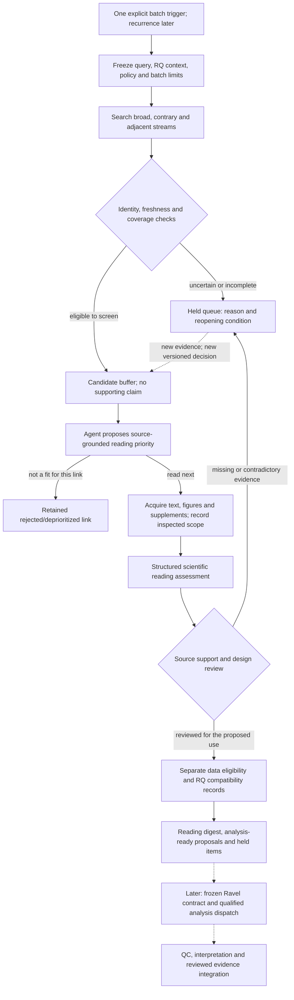

# Discovery and screening backend: next implementation sequence

**12 October 2026: implementation design, not a deployed autonomous service.**
Prioritize discovery-to-screening orchestration before the remaining Choi
publication closeout. The existing Choi attempt is a completed, exposed test of
manual compute, recovery and interpretation. Its merge is not a prerequisite for
building or evaluating candidate screening. Preserve its publication hold,
reservation and original evidence; do not rerun it.

## What exists and what does not

| Component | Current implementation | Missing qualification or implementation |
|---|---|---|
| Ravel context | `weft/context.py`; all 32 pinned question identities | Query profiles initially cover A0/A1, not every RQ; dossier contents need source-specific reading |
| Discovery | `weft/europe_pmc.py`, `weft/discovery.py`; explicit bounded searches, cursors, overlap windows and receipts | Batch orchestration, automatic window partitioning, broader recall evaluation and recurring trigger |
| Identity and deduplication | `weft/identity.py`; strong IDs, conflicts, changed-snapshot invalidation | Complete edition/correction-family reconciliation; dataset lineage is a separate relation |
| Candidate buffer | Persistent proposed links; `pending_review -> read_next / held / rejected` | Automatic source-grounded priority proposals and stage orchestration |
| Reading | `weft/reading.py`; open-access XML packets and assessment hash/locator checks | Semantic screening worker, figure/supplement retrieval and inspection coverage; independent screening evaluation |
| Scientific eligibility | G3-G8 specification and Ravel's existing runner/governance | Weft does not implement the semantic scientific gate engine or its full transitions |
| Job controls | `jobs.py`, `executor.py`, `checkpoints.py`, `recovery.py`, `transfer_parts.py`; tested synthetic execution and manual cloud recovery | Connect discovery/reading jobs to one authoritative durable queue and supported agent handoff |
| Live operation | Manually launched agent/cloud tasks | No unattended launcher, paid model API or recurring schedule configured |

Existing tests establish bounded software behavior, not that the system finds
all relevant papers or correctly judges scientific support. `validate-reading`
checks source identities and locator existence; it does not establish entailment.

## Three distinct decisions

Avoid a single paper-quality score or permanent paper-wide accept/reject label.
Decisions concern a stage, proposed use or paper-to-RQ link; the same paper can
have several different dispositions.

| Decision | Required reasoning | Permitted outcome |
|---|---|---|
| Worth reading? | Specific question/adjacent methodological insight, evidence inspected, contrary findings and access scope | Read next, hold for missing information, or deprioritize/reject this link with a reason |
| Suitable for a defined analysis? | Actual dataset files, biological units, conditions, measured endpoint, availability and compute fit | Eligible for bounded description or another identified work type; hold; or unsuitable for that proposed analysis |
| Does a finding connect to Ravel? | Current RQ evidence/amendments plus population, comparison, timing, endpoint, units and shared-source lineage | Proposed direct, contrary, adjacent, methodological or unsupported relationship; no accepted claim |

A useful paper without downloadable data can stay on the reading list. A strong
contrary result is not irrelevant because it disagrees with an RQ. No independent
animals can block a replicated-effect analysis while still permitting description.
Prestige affects optional reading order, never eligibility or truth. Personal
career interests remain private and separately justified; an unconfigured career
profile is unknown, not an inferred preference. Rejected links remain auditable.

## Backend flow to implement

All arrows above describe the target design. Existing commands implement some
individual steps; the end-to-end coordinator and semantic decisions are not yet
implemented. A model proposes reasons and cited findings. Deterministic controls
reject missing, changed, stale or unauthorized records. Scientific support requires
evaluation beyond valid JSON or a confidence score.

## Concrete implementation order

These slices refine M1/M2/M3; they do not renumber the roadmap or retroactively
change scientific authority. New gate semantics require explicit code review.

| Slice | Deliverable | Acceptance evidence |
|---|---|---|
| B1: batch coordinator | Bounded discovery command composing existing adapters; per-stage job keys, queue/events, receipts, explicit hold/resume and safe window partitioning | No duplicate candidate/job on replay; cutoff never advances over gaps or failed retrieval; crash/restart preserves prior decisions; stale context invalidates dependent work |
| B2: screening worker contract | Immutable input packet, source-bound priority/assessment schema, supported cloud-agent handoff and result ingestion | Missing/fabricated locator, stale metadata, prompt-injection instructions, wrong paper/RQ and malformed responses cannot authorize the next stage; agent failures preserve resumable holds |
| B3: evidence and dataset qualification | Figure/supplement coverage records; separate data-eligibility and RQ-compatibility records; cohort/accession lineage | Distinguish captions from inspected images; pooled units, absent controls, inaccessible files, incompatible endpoints and shared datasets constrain the proposed use correctly |
| B4: bounded screening batch | One initial trigger; agent processes a small fresh candidate queue and returns a digest with read/hold/link-reject reasons | Preserve every candidate and attempt; source-supported rationale; readable digest; all state/evidence exported and independently restorable; no biological analysis or Ravel write |
| B5: qualification and recurrence | Independently reviewed fresh-paper set, missed-paper audit, decision disagreement/error measures, supported recurring trigger and observable resource controls | Review low-ranked/rejected and contrary papers as well as successes; freeze evaluation criteria before the live batch; authorize cadence only after technical and quality checks |

Suggested implementation locations are new `weft/batches.py` and
`weft/screening.py`, with focused tests and versioned schemas/configuration.
These files do not exist yet. Reuse existing adapters and job controls rather
than create another competing SQLite authority. Reading/data fields must retain
unknowns, actor attribution, inspected scope and exact source/context hashes.

The first B4 batch should use freshly discovered candidates whose answers are
not taken from existing completed Ravel analyses. Record all prior exposure;
do not claim a blinded evaluation merely because the code runs in another task.
Use Choi as a regression/failure-case fixture, including the pooled-library and
absent-state cases. No new numerical paper reproduction is needed to test this
front end. Expand query profiles beyond A0/A1 through reviewed registry-grounded
profiles, without assuming that importing 32 RQs provides portfolio-wide coverage.

## Agent deployment and controls

Start with **one manually triggered cloud agent that autonomously processes a
bounded screening batch**. The operator initiates the batch, not every search,
paper read or routine state transition. A deterministic backend supplies the next
eligible packet and validates the returned record; the agent performs the reading.
This is the first automation target. A recurring trigger is a separate later layer.

Retain the selected dot/Codex Cloud route. We have demonstrated manual handoff,
not a supported unattended dispatch API or a persistence guarantee. Qualify the
actual supported handoff, queue restoration and model-output capture before live
automation. A missing API must result in a documented deployment decision, not
browser automation masquerading as a durable backend or an invented dot SDK.

Bind each run to the Ravel revision, source snapshots, query/policy versions,
agent/model identity where observable, limits and attempt key. Recheck live queue
state and metadata freshness at transitions, not just packet preparation. The
existing maximum 200 records per manual search is enforced; the proposed five
full reads per batch still needs enforcement by the new coordinator. Subscription
usage is not a known dollar budget. Missing usage measurements stay unknown.

Use one authoritative coordinator and verified private Drive checkpoints. Do not
activate a restored task-local ledger as a competing writer. The Choi reservation
is still held: reconcile its known outcome and preserve the pending publication
dependency before any new live dispatch. Implementing and fixture-testing B1-B3
does not depend on changing that reservation or merging Ravel PR #149.

## Remaining decisions and work boundary

No new credentials, paid service, schedule or scientific execution is needed to
implement the first backend slices and run deterministic tests. Before a live
batch, qualify the selected agent handoff and recovery using existing access.
If that route cannot enforce persistence, output capture or limits, present the
specific technical evidence and alternative deployment choice to the owner.
Before recurrence, obtain cadence, notification and usage-scope decisions.

Choi M5 remains a separate track: complete-output publication, unchanged receipt
registration, human review and merge. It is not cancelled and must not be marked
complete. The next useful demonstration is discovery -> screening -> a reasoned
candidate digest, not another manual reproduction of an already reviewed paper.
