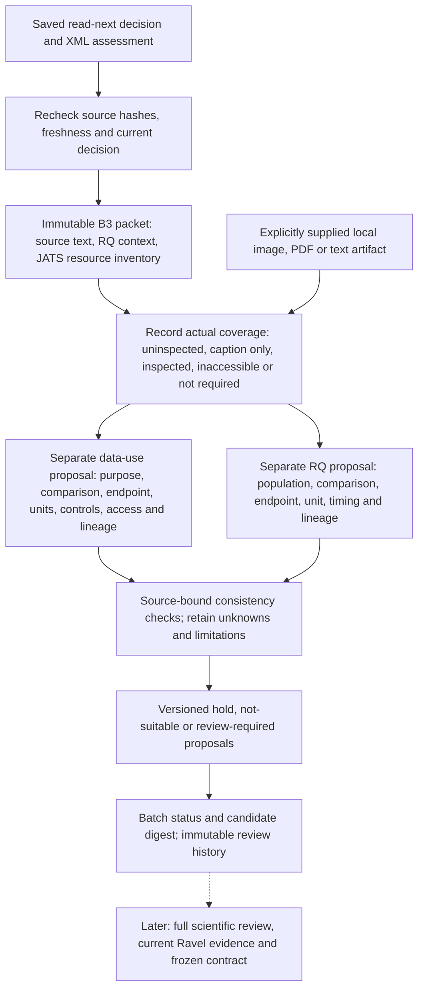

# B3 evidence coverage and proposed data use

**Implemented backend; scientific review and cloud qualification remain separate.**
The B3 interface inventories cached JATS resources, retains supplied local
evidence, and records two independent proposals: suitability for a stated data
use and compatibility with a pinned RQ. It never grants scientific execution,
accepts a claim, counts independent studies or writes to Ravel.

[Development evidence](../records/evidence-qualification-20261012.json) ·
[Cloud qualification and B4 hold](B3_CLOUD_B4_REVIEW.md) ·
[Batch interface](BATCH_SCREENING.md) · [Roadmap](DISCOVERY_SCREENING_BACKEND.md)

## Connection to the existing backend



No arrow calls a model, downloads a figure, follows an XML URL or starts analysis.
The agent performs review through its available tools; this interface supplies
the evidence packet and validates the returned record. Existing search/reading
caps and the separate Choi ledger are unchanged.

## Commands

Run these on one designated development or restored store, with its other writers
quiesced. `batch-evidence` requires a current `read_next` decision and a saved
source-bound XML assessment, including a held assessment. It rechecks the existing
seven-day metadata freshness limit; it never silently refreshes old metadata.

```bash
python -m weft batch-evidence --store STORE --batch BATCH_ID --candidate CANDIDATE_ID
python -m weft batch-attach-evidence --store STORE --batch BATCH_ID \
  --candidate CANDIDATE_ID --resource RESOURCE_ID --file figure.pdf \
  --origin 'Exact source URL or source locator'
python -m weft batch-submit-evidence --store STORE --batch BATCH_ID --assessment proposal.json
python -m weft batch-evidence-status --store STORE --batch BATCH_ID --candidate CANDIDATE_ID
python -m weft batch-digest --store STORE --batch BATCH_ID
```

The first command returns `packet`, its SHA-256, instructions and
`response_template`. Save the response template as UTF-8 JSON and edit it; source
text and packet hashes must remain unchanged. CLI output contains source text and
belongs in private working storage. It is not a public report.

Attachment copies only the explicitly supplied file. It records the declared
origin without fetching it. Supported evidence is PNG, JPEG, PDF and UTF-8
TXT/CSV/TSV, bounded to 32 MiB per file and 64 attachments / 256 MiB per packet.
These are operational intake limits, not biological thresholds. Larger or
unsupported supplements stay uninspected until a separately reviewed adapter is
available. No file is executed or automatically rendered. Format signatures are
not a proof of valid rendering; the reviewer must inspect the material with an
appropriate viewer and accurately record the scope.

## Record contract

The version 1 template is generated by `weft/qualification.py`. Unknown values
are explicit; filling a template must never invent metadata. Unsupported fields,
changed source identity, invented locators and acceptance/dispatch flags fail.

| Component | Required content | Constraint |
|---|---|---|
| Identity | Batch/candidate, packet hash, actor, actor kind and prior exposure | Actor attribution is self-reported, not authenticated |
| Coverage | Exactly one entry for every inventoried resource; status and inspection note | XML inventory completeness is limited to resources listed in that XML |
| Data proposal | Purpose, comparison, measured endpoint, biological unit, inference, independence, controls, access, dataset map and source citations | Missing required evidence produces a hold for the proposed use |
| Dataset map | Accession, file identifiers, unit mapping, cohort and source relationship, with citations | Duplicate accession entries fail; shared or uncertain data never become independent replication |
| RQ proposal | Population, comparison, endpoint, biological unit, timing and lineage dimensions; relation and reason | Each known dimension cites source text; the target description is bound to the packet's pinned discovery context |
| Revision | Previous record hash and amendment reason | Amend the latest record; old records remain recoverable |
| Authority | Claim validated, scientific execution and verified actor identity remain false | No proposal is a G3–G8 transition or Ravel admission |

Each source citation contains `locator` and `segment_sha256` from the packet.
Hashes and locator existence do not establish semantic support. A new reviewer
must assess whether the cited evidence supports the statement.

Coverage statuses are `not_inspected`, `caption_only`, `inspected`, `inaccessible`
and `not_required`. An inspected resource needs an attachment bound to that
packet and resource. Figure inspection additionally requires a retained image or
PDF; caption text cannot satisfy it. An image/PDF receipt records bytes, not proof
that the right panel was seen. The actor's inspection note must identify the
actual material/pages/panels and remaining limits. `not_required` needs a reason
for the stated use; it is not a claim that the resource was inspected.

Data-use purposes are description, replication, prediction, perturbation-effect
estimation and exploration. Inference is explicitly descriptive, within-sample
or replicated-population. A pooled-only mapping can support a descriptive
proposal; it cannot support the replicated-population proposal. A perturbation
effect requires documented controls. No universal donor count, effect-size or
significance cutoff is introduced. `access: documented` means cited availability,
not verified download or authorization to use controlled data. File/sample
mapping and cohort labels remain source-grounded reviewer assertions.
Cross-paper cohort reconciliation still requires review; this interface stores
lineage assertions and rejects duplicate accessions within a proposal, but does
not infer independent cohorts across the literature.

Each compatibility dimension is `match`, `mismatch`, `unknown` or `not_applicable`.
The proposed relation can be direct, contrary, adjacent, methodological,
shared-source or unclear. A mismatch is informative; it need not make the paper
uninteresting. It holds a proposal for that exact RQ use while preserving the
paper and other links.

Both proposals independently use `hold`, `not_suitable` or `review_required`.
Uninspected required resources, missing design/dataset information or unresolved
matching dimensions cannot be labelled review-required through this interface.
An explicitly narrowed use may exclude a resource with a recorded reason.
`review_required` means the structured proposal is ready for further review,
not that its source support or scientific eligibility has passed. In particular,
the RQ packet is discovery context: current Ravel results, amendments and intended
contract still require separate review before scientific admission.

## Preservation and recovery

The existing discovery catalog receives three additive tables: `evidence_packets`,
`evidence_artifacts` and `evidence_reviews`. Events are appended to `batch_events`;
reading-priority events and candidate states are not changed. Artifacts use
content-addressed, store-relative paths. Linked targets, foreign resources and
changed bytes fail validation. Invalid proposals leave prior records intact.

Repeated submission is idempotent. Replaying a superseded record returns
`already_recorded` with `current: false`; it cannot revive the old decision.
Every amendment references the latest review hash and records its reason.
Current status revalidates the source, decision, packet, record and referenced
artifacts. Changed/stale evidence produces a non-current hold. The catalog is a
trusted local store, not an authenticated or tamper-proof audit service.

Recovery copies the closed catalog and all store artifacts, verifies a manifest,
then reuses the packet and response without fetching. Prevent competing writers;
this is not distributed fencing. Full texts, attachments, paths and raw review
records remain private. A compact public check record does not authorize export
of a new private checkpoint.

## Observed development test and next boundary

The verified after-screening checkpoint was copied into a new inactive development
store. Its existing paper, DOI `10.1002/advs.77773` / PMC13634473, yielded six figure
entries and two supplement entries. This is an XML inventory, not eight inspected
artifacts. The demonstration recorded both proposals as held and made zero network
calls. It preserved the original checkpoint, all source bytes, reading decisions
and original 20-event prefix; only two B3 events were appended to the copy.
Fresh-path recovery returned the same packet and idempotent review without
duplicate events. This exposed software test is not an independent paper review.

PR #7 subsequently passed B3 operational qualification in the existing screening
cloud worker. The [bounded B4 review](B3_CLOUD_B4_REVIEW.md) remains paused before
material acquisition at the recorded documentation-host/browser permission boundary.
Its actual figure/supplement coverage and data/compatibility records are still due.
If required material needs a new host, credentials, unsupported renderer or a
different deployment, retain the hold and request that specific decision. B5
must evaluate unseen papers, contrary/low-ranked findings and errors before
recurrence is proposed. Choi publication remains a separate track.
