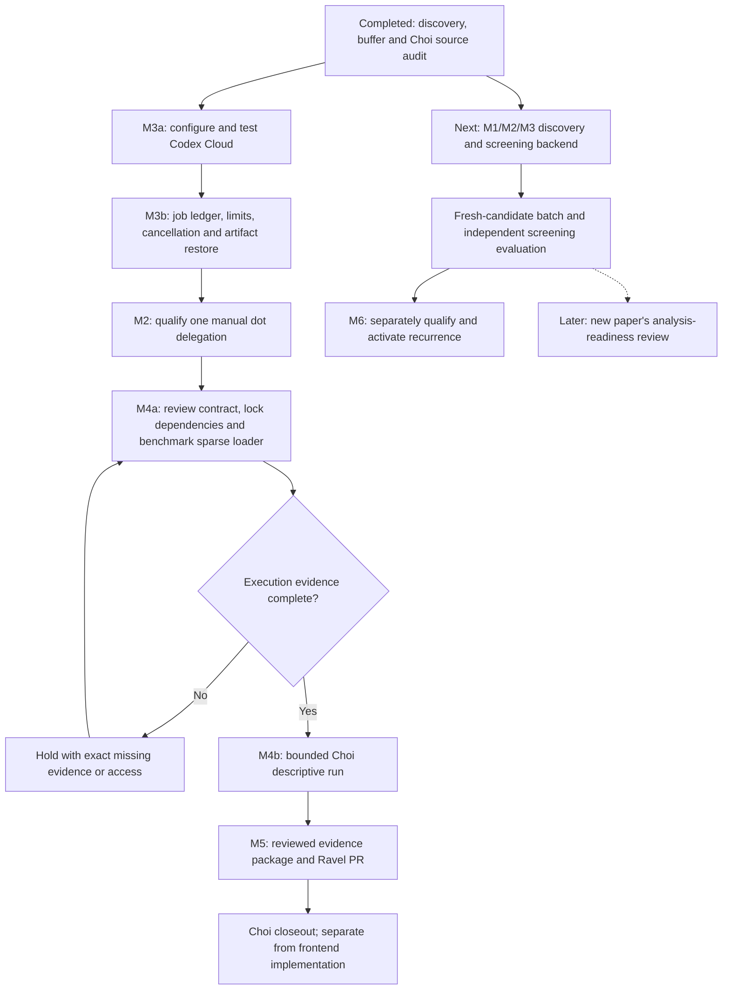

# Implementation plan

## Objective and selected execution route

Build an agent-operated system that discovers papers, reviews relevance, qualifies
reusable data, runs bounded reanalysis and proposes traceable evidence for Ravel.
Missing evidence produces a hold; a completed job does not confer scientific acceptance.

**Owner-selected direction, 11 October 2026: a dot coordinates; Codex Cloud runs
versioned code and scientific jobs after qualification. No additional local PC is
required.** Local Codex remains available for development and manual review. The
prior local-reader choice describes the completed baseline, not a requirement
that future computation remain local. See [the decision record](../DEVELOPMENT.md).

The first end-to-end release finishes when [P001](PILOT_CHOI_2020.md) produces a
reviewable Ravel evidence package, including its unreplicated-effect hold and a
candidate/no-candidate disposition. A positive phenotype or new RQ is not required.

## Responsibility and deployment

| Component | Assigned responsibility | Evidence / implementation boundary |
|---|---|---|
| Dot | Coordinate bounded tasks, source reading, holds and reports through supported product delegation | Structured dispatch/return records; no assumed dot SDK or unattended integration |
| Weft | Discovery, pinned RQ context, proposal buffer, gates, job ledger and export preparation | Discovery/buffer/manual reader and synthetic executor/recovery implemented; scientific orchestration incomplete |
| Codex Cloud | Execute tested repository commands in a qualified published environment | Exact source/dependency versions, input/output manifests, QC and resource receipts |
| Ravel | Canonical RQs, contracts, analysis code, results and acceptance history | Read-only pinned context initially; later scoped, reviewed PR |
| GitHub CI | Deterministic software/document checks | CI status; no scientific compute or desktop runner |
| Local X: storage | Existing archives, optional development and downloaded backups | Not a dependency of a cloud task; never assume X: exists remotely |

One coordinator is sufficient. Separate roles do not require separate agents and
are not independent biological replication. A source match enters the
[decision buffer](DECISION_BUFFER.md); it never directly becomes a supporting claim.

## Next priority: automate discovery and screening

The [backend implementation sequence](DISCOVERY_SCREENING_BACKEND.md) now takes
priority: B1 batch coordination -> B2 source-grounded agent screening -> B3 data
and RQ compatibility -> B4 a bounded fresh-candidate batch -> B5 evaluation and
separately authorized recurrence. These refine M1/M2/M3. Current Choi execution
was manually coordinated. B1 coordination and the B2 pull interface are now
implemented and [tested on fresh candidates](BATCH_PILOT_20261012.md). The
[manual cloud handoff and checkpoint recovery](SCREENING_CLOUD_QUALIFICATION.md)
also passed. Independent screening quality and unattended operation remain open.
Choi M5 publication remains open on a separate track and is not a prerequisite
for developing or evaluating the discovery/screening backend. Preserve its held
reservation; reconcile before new scientific dispatch through that ledger. No
gate or schedule is enabled
by these development changes.

## Development stages and exit criteria

Keep M0-M6 identifiers so existing receipts retain their meaning. M3/M4 are split
into implementation slices below; these are not new scientific gates.

| Order / milestone | Work and deliverable | Exit criterion | Current status |
|---|---|---|---|
| 0 / M0-M2 baseline | Foundation, bounded discovery/dedup, pinned RQs, manual reader, Choi source review | Reuse recorded tests/audit and preserve unresolved limits | Implemented baseline; M1 version-family/recall evaluation and M2 independent screening evaluation remain open |
| 1 / M3a cloud setup | Private `weft-pilot`; exact Weft PR revision; read-only Ravel pin; Python/Git/network preflight | Fresh cloud task passes offline checks and pin verification; capability/access receipt recorded | Published at d031cef: 58 tests, 15 Ravel files and small external restore and fresh-task source checks passed; startup/network caveats recorded |
| 2 / M3b job and artifact control | Single authoritative ledger, job keys, leases, append-only attempts, checkpoint/export, cancellation and enforced limits | Synthetic duplicate, expired lease, changed hash, stale context, disconnect, cancellation and restore tests pass | 122 Linux tests, bounded executor/restart and Drive cross-task recovery passed; manual metadata completed and Figure1 archive independently verified; unattended integration incomplete |
| 3 / M2 cloud coordinator qualification | One manual dot delegation, source-bound reading, structured return and hold handling | Dot uses the selected environment/revision and verifies receipts without bypassing holds; independent screening evaluation remains separate | Manual dispatch/return and SQLite checkpoint passed; no schedule or automatic scientific dispatch |
| 4 / M4a scientific readiness | New Ravel contract/adapter, dependency lock, comparison criteria, verified transfer and sparse-loader benchmark | Coordinates/values and joins pass; measured memory fits enforced limits; artifact export/restore passes | Frozen contract/runtime and metadata verified; 4 MiB synthetic recovery passed; real Figure1 archive passed independent reconstruction and all member checks |
| 5 / M4b Choi pilot | Figure 1B-D descriptive adapted reanalysis, exposure record and discrepancy ledger | Complete QC/denominators, all attempts and limitations; no population inference from one pooled library per condition | Executed once; archive verified; [QC, figures and paper comparison reviewed](PILOT_CHOI_SCIENTIFIC_REVIEW.md); no new RQ proposed, annotation limits retained |
| 6 / M5 reviewed integration | Precedent review, candidate/no-candidate disposition, manifest, scoped Ravel PR and CI | Current Ravel base checked; evidence traceable; acceptance/merge recorded separately | Scientific review in draft Ravel PR #149; complete-output publication and human review remain open |
| 7 / M6 prospective operation | Freeze unseen-paper evaluation; assess recall, source support, recovery and usage; then propose recurrence | Reviewed criteria met and cadence/scope/usage authority recorded | Planned; automation disabled |

Each slice needs scoped changes, tests and observed limitations. Resolve correction/
version-family coverage and independent screening evaluation before claiming
M1/M2 qualification or unattended operation. Choi remains an exposed benchmark.

Future arrows are not implemented enforcement. The [cloud runbook](CLOUD_SETUP.md)
records the completed setup and qualification handoff; [environment qualification](EXECUTION_ENVIRONMENT.md) owns
resource requirements. Setup can pass while scientific execution remains held.

## State and artifacts to implement in M3

The owner selected the [checkpointed manual route](MANUAL_PILOT.md): one dot-owned
SQLite ledger, private Drive checkpoints before/after each job, and explicit
operator recovery after interruption. Actual dot execution, cloud dispatch/return
and synthetic SQLite backup/restore passed. Dot scratch storage has no verified
restart-retention guarantee, and Drive is not a distributed lock or write-once
store. Per-job integration remains to implement; independent task-local SQLite
copies never become separate dispatch authorities. No always-on local PC or new
service is selected.

Workers receive immutable packets: paper/version, RQ-context/policy hashes,
contract/code/input identifiers, attempt/lease IDs, output destination and limits.
A deterministic job key prevents duplicate logical jobs. Retries retain earlier
attempts; scientific parameter changes require an amendment and new key. An expired
lease with an unknown worker outcome holds redispatch until reconciled.

Workers return manifests, hashes, logs, QC and exit/cancellation/resource receipts.
Verify these before transitions. Export required artifacts before marking a job
complete and test restoration outside the original task. Compact public receipts
may enter Git. Full texts, private preferences, SQLite state and large outputs
need appropriately permissioned storage outside public Git. Qualify the initial
artifact destination before M4; no paid store is implicitly selected.

## Usage and failure policy

Start with one manually dispatched cloud task, without a recurring responsibility.
The product route uses the signed-in account; current standard-library Weft
commands need no OpenAI API key. Record observable Work/Codex usage or mark it
unavailable; do not convert account percentages to invented dollar charges.
Existing `model_usd_*` fields are inactive API-route proposals, not enforceable
subscription caps. M3 must implement/review a product-route budget representation
before unattended dispatch.

The one-job, six-hour and 20-GiB download proposals in `configs/policy.json` are
ceilings to qualify, not OpenAI runtime guarantees. Use the smaller of approved
workload limits and measured platform limits. If memory/time/process cancellation
cannot be enforced, hold science and identify the missing control. Text instructions
are not resource limiters. Unknown outcomes, drift, interrupted export and usage
exhaustion retain resumable holds/attempts; do not retry blindly.

## Next code slice

B1 and B2 packet/result mechanics are implemented; the fresh-candidate development
digest records 74 papers, five screened links and a held selected-text assessment.
Path reconciliation and local cross-root recovery are implemented and tested.
[Cloud qualification](SCREENING_CLOUD_QUALIFICATION.md) has verified the approved
host amendment, separate screening-only task, source checks and bounded discovery.
Five cloud screening responses, both exact owner-approved Drive checkpoints and
independent Linux-to-Windows cached recovery passed. Manual handoff/recovery is
qualified; no unattended launcher is configured. [B3 records](EVIDENCE_QUALIFICATION.md)
now support inspected-scope coverage, bounded local artifacts, data-use suitability
and RQ compatibility as separate versioned proposals. Its cached-source test held
both proposals and preserved prior evidence. PR #7 d95d558 then passed 55 targeted
cloud tests and another-path held-proposal recovery in the existing worker.
[Bounded B4 source review](B3_CLOUD_B4_REVIEW.md) is paused before acquisition;
the owner reports publishing the documentation-host grant, but the same worker
still enforces the old policy. No supported in-place adoption control is exposed.
The owner authorized one new screening worker; launch, policy verification and
checkpoint restoration must pass before resuming. See PROGRESS for the handoff. Freeze
independent screening evaluation before using quality metrics or enabling recurrence. See [deliverables and acceptance tests](DISCOVERY_SCREENING_BACKEND.md#concrete-implementation-order).
The synthetic executor, checkpoint and transfer modules already exist; do not
reimplement them or claim that their existence supplies semantic screening.
No automatic acceptance, merge, RQ registration, paid fallback or schedule follows.
