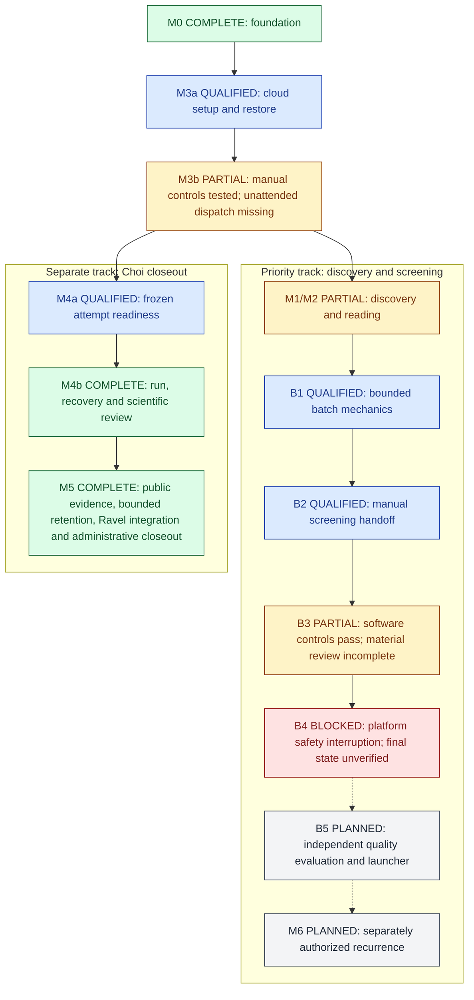

# Implementation plan

## Objective and selected execution route

Build an agent-operated system that discovers papers, reviews relevance, qualifies
reusable data, runs bounded reanalysis and proposes traceable evidence for Ravel.
Missing evidence produces a hold; a completed job does not confer scientific acceptance.

**Owner-selected direction, 11 October 2026: a dot coordinates; Codex Cloud runs
versioned code and scientific jobs after qualification. No additional local PC is
required.** Local Codex remains available for development and manual review. The
prior local-reader choice describes the completed baseline, not a requirement
that future computation remain local. See [the decision record](../DEVELOPMENT.md).

The first end-to-end release finishes when [P001](PILOT_CHOI_2020.md) produces a
reviewable Ravel evidence package, including its unreplicated-effect hold and a
candidate/no-candidate disposition. A positive phenotype or new RQ is not required.

## Established state

Status as of **13 October 2026**.

**Current position: a tested manual workflow plus synthetic handoff/intake controls, with B4 blocked and unattended
operation still planned.** Cloud execution and checkpoint recovery work within
the recorded scopes; independent screening quality and general scientific
authorization are not established.

| Track | Established | Remaining |
|---|---|---|
| Discovery and screening | Bounded Europe PMC discovery, deduplication, pinned RQ context, decision buffer, manual agent handoff and recovery | B3 material/semantic qualification, blocked B4 review, B5 independent evaluation and unattended launcher |
| Cloud controls | Published environment, manual coordinator and verified Drive recovery; owner-operated task passed 18 pinned fixtures once; Mir's selector/catalog version reconciled; owner screenshots confirm the network preset and full custom-host list | One native task admitted; HOLD receipt/log recovered, zero tests invoked. Same-child runtime-status access and prompt-byte reconciliation pending; independent AI-host identity, enforcement, ownership and usage controls unqualified. Browser blocked; CLI optional and unmapped |
| Choi pilot | M4/M5 complete for the bounded benchmark: public outputs, verified recovery, owner descriptive retention and Ravel #149 merged; final 32-event administrative release independently recovered | Preserve bounded interpretation and checkpoint ancestry; no new-job authority or general scientific eligibility inferred |
| Integration into main | Weft PRs #1-#10 and Ravel #149/#150 merged with passing CI; #10 control review completed within its cooperative scope | Offline launch-intent journal implemented/tested in open PR #11; diagnosis and remote architecture revisions remain local; no fresh-paper scientific acceptance |

The [backend handoff note](BACKEND_HANDOFF.md) describes the tested controls;
[launcher qualification](LAUNCHER_QUALIFICATION.md) owns the deployment boundary.
[B5 preparation](B5_EVALUATION_PREPARATION.md) records decisions to freeze, without
inventing labels or claiming an independent evaluation has run.
The [launcher readiness decision](AUTOMATED_LAUNCH_READINESS.md) records the
remaining access dependency and the [offline intent/recovery guard](LAUNCH_INTENT_RECOVERY.md).
Its local journal does not establish remote dispatch or distributed ownership.

The [remote architecture](REMOTE_AUTOMATION_ARCHITECTURE.md) now prioritizes native
Mir delegation to the existing environment. L0 now has Mir's owner-relayed schema
and target catalog, with historical version continuity independently checked;
[owner observations](qualification/NATIVE_LAUNCH_INTERFACE.md) now include
same-workspace picker availability and configured network settings. Retain owner
attribution rather than claim independent AI-host identity verification. The
[native trial](qualification/NATIVE_RUNTIME_HOLD.md) was admitted once and its
HOLD result recovered; tests remain unstarted. L1 is partial while the same-child
runtime capability and prompt-byte provenance are diagnosed. CLI is optional.
L1 requires the bounded execution result after admission,
L2 ownership/recovery without PC dependencies, L3 bounded search/screening and B5
quality, and L4 separately authorized recurrence. These slices preserve existing
milestone IDs and all scientific holds; no new service or live adapter is selected.

The [PR stack audit](PR_STACK_INTEGRATION.md) records merge order and verified
conflict status. Implementation/testing, merge status and scientific acceptance
are separate. No overall completion percentage is assigned to unequal milestones.

## Responsibility and deployment

| Component | Assigned responsibility | Evidence / implementation boundary |
|---|---|---|
| Dot | Coordinate bounded tasks, source reading, holds and reports through supported product delegation | Native cloud-thread capability is documented; actual launcher/mapping, ownership and unattended integration await qualification; no assumed dot SDK |
| Weft | Discovery, pinned RQ context, proposal buffer, gates, job ledger and export preparation | Discovery/buffer/manual reader and synthetic executor/recovery implemented; scientific orchestration incomplete |
| Codex Cloud | Execute tested repository commands in a qualified published environment | Exact source/dependency versions, input/output manifests, QC and resource receipts |
| Ravel | Canonical RQs, contracts, analysis code, results and acceptance history | Read-only pinned context initially; later scoped, reviewed PR |
| GitHub CI | Deterministic software/document checks | CI status; no scientific compute or desktop runner |
| Local X: storage | Existing archives, optional development and downloaded backups | Not a dependency of a cloud task; never assume X: exists remotely |

One coordinator is sufficient. Separate roles do not require separate agents and
are not independent biological replication. A source match enters the
[decision buffer](DECISION_BUFFER.md); it never directly becomes a supporting claim.

## Next priority: automate discovery and screening

The [backend implementation sequence](DISCOVERY_SCREENING_BACKEND.md) now takes
priority: B1 batch coordination -> B2 source-grounded agent screening -> B3 data
and RQ compatibility -> B4 a bounded fresh-candidate batch -> B5 evaluation and
separately authorized recurrence. These refine M1/M2/M3. Current Choi execution
was manually coordinated. B1 coordination and the B2 pull interface are now
implemented and [tested on fresh candidates](BATCH_PILOT_20261012.md). The
[manual cloud handoff and checkpoint recovery](SCREENING_CLOUD_QUALIFICATION.md)
also passed. Independent screening quality and unattended operation remain open.
Choi M5 is complete for its bounded descriptive benchmark and is not a prerequisite
for developing or evaluating the discovery/screening backend. Its owner-authorized
administrative release is now independently verified in the final private checkpoint.
Preserve original evidence and checkpoint ancestry; keep verification copies inactive.
No new scientific job, gate or schedule is enabled by these development changes.

## Development stages and exit criteria

Keep M0-M6 identifiers so existing receipts retain their meaning. M3/M4 are split
into implementation slices below; these are not new scientific gates.

Status key: **Complete** = the named bounded deliverable finished; **Qualified** =
the stated operational checks passed; **Partial** = implementation exists but
exit criteria remain; **Open** = unfinished integration/review; **Planned** = not
qualified or activated. A **Blocked** backend slice is marked separately below.
These labels do not promote any scientific claim or record human acceptance.

| Milestone | Status | Established evidence | Remaining exit requirement |
|---|---|---|---|
| M0 foundation | **Complete — baseline** | Repository, source pins, Ravel context and decision-buffer ownership are implemented; [integration contract](RAVEL_CONNECTION.md) | Preserve version/authority boundaries as features extend |
| M1 discovery and identity | **Partial** | Bounded search, deduplication, batch coordination and receipts; [development batch](BATCH_PILOT_20261012.md) | Broader recall, correction/edition-family reconciliation and query coverage beyond A0/A1 |
| M2 reading and coordinator | **Partial** | Source-bound XML packets, five manual cloud screening responses, dot dispatch/return and checkpoint recovery; [cloud qualification](SCREENING_CLOUD_QUALIFICATION.md) | Complete figure/supplement/design review and independent screening evaluation; general automated eligibility remains unimplemented |
| M3a cloud setup | **Qualified — selected environment** | Setup d031cef; new task confirmed enforced policy, exact source pins and 42-member restore; [latest receipt](../records/b3-cloud-b4-boundary-20261012.json) | Recheck live readiness per job; current B4 interruption is a separate platform hold |
| M3b job and artifact controls | **Partial — manual route qualified** | Ledger/leases, bounded executor, synthetic cancellation/recovery, manual coordinator and verified Drive checkpoints; [job controls](JOB_CONTROLS.md) | Supported unattended launcher, durable queue ownership, usage controls and failure qualification for that route |
| M4a scientific readiness | **Qualified — frozen Choi attempt only** | Contract/runtime, metadata, bounded preflight and artifact recovery verified; [pilot records](MANUAL_PILOT.md) | Each new paper/use requires its own contract, inputs, resource checks and authorization |
| M4b Choi pilot | **Complete — adapted descriptive attempt and QC** | Executed once; archive hashes and [scientific comparison](PILOT_CHOI_SCIENTIFIC_REVIEW.md) reviewed | Retain annotation/denominator limits; no exact reproduction, new RQ or human acceptance implied |
| M5 reviewed integration | **Complete — bounded Choi benchmark and administrative closeout** | [Closeout record](M5_PUBLICATION_PLAN.md): all 15 outputs, original receipt, public recovery, owner descriptive retention, Ravel #149 merged and main CI passed; final private release checkpoint independently restored | Retain all limits and ancestry; any future scientific job needs its own contract and authority |
| M6 prospective operation | **Planned — disabled** | Evaluation/recurrence requirements specified | B5 unseen-paper evaluation, supported unattended operation and explicit cadence/scope/usage decisions |

Existing acceptance criteria retained by this status update

| Milestone / slice | Acceptance requirement |
|---|---|
| M0-M2 baseline | Reuse recorded tests/source audits and preserve unresolved limits; complete version-family/recall and independent screening evaluation before claiming full M1/M2 qualification |
| M3a setup | Fresh cloud task passes offline checks and exact source-pin verification; capability/access receipt recorded |
| M3b controls | Synthetic duplicate, expired lease, changed hash, stale context, disconnect, cancellation and restore tests pass |
| M2 cloud coordinator | Selected environment/revision, structured dispatch/return and receipt verification without bypassing holds; independent screening evaluation remains separate |
| M4a readiness | Coordinates/values and joins pass; measured memory fits enforced limits; artifact export and independent restore pass |
| M4b Choi | Complete QC/denominators, all attempts, exposure and limitations; no population inference from one pooled library per condition |
| M5 integration | Current Ravel base checked, complete evidence traceable, and acceptance/merge recorded separately |
| M6 operation | Prospective evaluation criteria met and explicit cadence, scope and usage authority recorded |

Each slice needs scoped changes, tests and observed limitations. Resolve correction/
version-family coverage and independent screening evaluation before claiming
M1/M2 qualification or unattended operation. Choi remains an exposed benchmark.

Labels are current status within the named scope; arrows show dependencies, not
implemented enforcement or permission to dispatch. B3 qualification covers its
software controls, not completed scientific/source review. Choi M5 does not block
backend development. See [B1-B5 status](DISCOVERY_SCREENING_BACKEND.md#current-b1-b5-status)
and [current interruption evidence](B3_CLOUD_B4_REVIEW.md). The [cloud runbook](CLOUD_SETUP.md)
and [environment qualification](EXECUTION_ENVIRONMENT.md) retain setup/resource requirements.

## M3 implemented controls and remaining integration

The owner selected the [checkpointed manual route](MANUAL_PILOT.md): one dot-owned
SQLite ledger, private Drive checkpoints before/after each job, and explicit
operator recovery after interruption. Actual dot execution, cloud dispatch/return
and synthetic SQLite backup/restore passed. Dot scratch storage has no verified
restart-retention guarantee, and Drive is not a distributed lock or write-once
store. The Choi jobs exercised manual per-job integration; generalized unattended
integration remains open. Independent task-local SQLite copies never become
separate dispatch authorities. No always-on local PC or new
service is selected.

Workers receive immutable packets: paper/version, RQ-context/policy hashes,
contract/code/input identifiers, attempt/lease IDs, output destination and limits.
A deterministic job key prevents duplicate logical jobs. Retries retain earlier
attempts; scientific parameter changes require an amendment and new key. An expired
lease with an unknown worker outcome holds redispatch until reconciled.

Workers return manifests, hashes, logs, QC and exit/cancellation/resource receipts.
Verify these before transitions. Export required artifacts before marking a job
complete and test restoration outside the original task. Compact public receipts
may enter Git. Full texts, private preferences, SQLite state and large outputs
need appropriately permissioned storage outside public Git. The existing private
Drive route passed the recorded transfers and restores; each new payload still
needs its own verification. No paid store is implicitly selected.

## Usage and failure policy

Start with one manually dispatched cloud task, without a recurring responsibility.
The product route uses the signed-in account; current standard-library Weft
commands need no OpenAI API key. Record observable Work/Codex usage or mark it
unavailable; do not convert account percentages to invented dollar charges.
Existing `model_usd_*` fields are inactive API-route proposals, not enforceable
subscription caps. M3 must implement/review a product-route budget representation
before unattended dispatch.

The one-job, six-hour and 20-GiB download proposals in `configs/policy.json` are
ceilings to qualify, not OpenAI runtime guarantees. Use the smaller of approved
workload limits and measured platform limits. If memory/time/process cancellation
cannot be enforced, hold science and identify the missing control. Text instructions
are not resource limiters. Unknown outcomes, drift, interrupted export and usage
exhaustion retain resumable holds/attempts; do not retry blindly.

## Next permissible work

B1 and B2 packet/result mechanics are implemented; the fresh-candidate development
digest records 74 papers, five screened links and a held selected-text assessment.
Path reconciliation and local cross-root recovery are implemented and tested.
[Cloud qualification](SCREENING_CLOUD_QUALIFICATION.md) has verified the approved
host amendment, separate screening-only task, source checks and bounded discovery.
Five cloud screening responses, both exact owner-approved Drive checkpoints and
independent Linux-to-Windows cached recovery passed. Manual handoff/recovery is
qualified; no unattended launcher is configured. [B3 records](EVIDENCE_QUALIFICATION.md)
now support inspected-scope coverage, bounded local artifacts, data-use suitability
and RQ compatibility as separate versioned proposals. Its cached-source test held
both proposals and preserved prior evidence. PR #7 d95d558 then passed 55 targeted
cloud tests and another-path held-proposal recovery in the existing worker.
[Bounded B4 source review](B3_CLOUD_B4_REVIEW.md) remains incomplete. The new
screening worker confirmed enforced policy, restored the verified checkpoint and
passed 55 targeted tests, then its source-review turn was rejected by platform
safety filtering. Administrative closeout was also rejected. Final download/store
state needs reconciliation after the platform hold is resolved; see PROGRESS.
Preserve the old worker and Choi, and do not use another route to bypass the hold.
Freeze independent screening evaluation before using quality metrics or enabling recurrence. See [deliverables and acceptance tests](DISCOVERY_SCREENING_BACKEND.md#concrete-implementation-order).
The synthetic executor, checkpoint and transfer modules already exist; do not
reimplement them or claim that their existence supplies semantic screening.
No automatic acceptance, merge, RQ registration, paid fallback or schedule follows.
