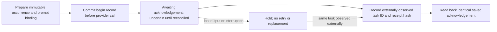

# Submission intent and acknowledgement recovery

Status: **implemented and tested offline; no cloud provider adapter or deployment**.
This closes the missing persisted-intent part of the manual procedure. It does not
retroactively qualify the earlier owner-launched task, or replace the job ledger.

`weft/launches.py` records a synthetic task's operation key, repository revision,
exact prompt hash, and account/environment/policy fingerprints before a proposed
submission. These fingerprints are operator-supplied evidence. This module does
not authenticate an account, fetch current policy or grant permission to dispatch.



There is deliberately no provider-call arrow implemented by this module. A future
adapter must first establish account/environment access and receive separate job
authority. It must call `begin` successfully before making at most one provider
call. If that call or its acknowledgement is uncertain, retain the hold and find
the same task through a supported interface. Do not infer non-submission from an
empty listing, timeout, elapsed lease or missing response.

## Commands and private records

Use a new file under ignored `runs/`, separate from the Choi ledger and screening
catalog. Existing files, including partially initialized journals, are never
overwritten. An incomplete initialization stays available for operator review.

```text
python -m weft launch-init --journal runs/example/launches.sqlite
python -m weft launch-prepare --journal runs/example/launches.sqlite --spec runs/example/spec.json --prompt runs/example/prompt.txt
python -m weft launch-begin --journal runs/example/launches.sqlite --spec runs/example/spec.json --prompt runs/example/prompt.txt
python -m weft launch-status --journal runs/example/launches.sqlite --operation example-occurrence
python -m weft launch-ack --journal runs/example/launches.sqlite --operation example-occurrence --receipt runs/example/ack.json
```

All five commands are offline bookkeeping. `launch-begin` does not launch a task.
It commits `awaiting_ack` before returning, so lost output cannot authorize retry.
Only one uncertain submission is permitted in this journal. Preparation and exact
acknowledgement replay are idempotent; beginning an occurrence twice is refused.
Changed source, prompt, account, environment or policy cannot reuse an occurrence.
Acknowledgement binds the saved specification hash to one observed task ID and
an externally retained observation hash; conflicting receipts stay rejected.
The same task ID cannot acknowledge a second operation in this journal, even
after the first acknowledgement. An inconsistent saved state, receipt or event
history is rejected. Reading state and history uses one SQLite snapshot so a
concurrent valid transition does not cause a false corruption report.

The strict version-1 specification contains `schema_version: 1`,
`kind: synthetic-qualification`, a stable `operation_key`, `repository`, the
40-character `source_revision`, 64-character `prompt_sha256`, `environment_sha256`,
`policy_sha256`, `account_scope_sha256`, and `max_submissions: 1`. Retain the exact
prompt separately (1–100,000 bytes). Do not put tokens or credential values in
either file. Supply actual reviewed fingerprints rather than invented examples.

The acknowledgement contains only `operation_key`, `spec_sha256`, `task_id` and
`observation_sha256`. It is an operator record, not verified provider evidence.
Task termination, result validation and artifact recovery are separate checks.
An acknowledgement neither means task completion nor frees a scientific-job slot.

## Recovery and limits

- Transactional `BEGIN IMMEDIATE` serializes cooperating callers. An interrupted
  transaction rolls back; a committed begin with lost output remains uncertain.
- Reopening the same journal preserves its state. A moved/restored copy can be
  inspected but refuses writes because its host/path binding differs. There is no
  force-rebind, reset, retry or automatic reassignment operation.
- A same-host/same-path rollback, cloned host or administrator database edit is
  outside this guard. Hashes detect accidental content changes; they are not
  signatures. External launchers and different journals can bypass this discipline.
- Do not mint another operation key to escape an uncertain launch. Operation
  identity, single-writer ownership and source freshness remain operator duties.
- This is not distributed fencing, a durable cloud service, active-task capacity
  enforcement, a scheduler, a cost meter, provider idempotency or a process watchdog.
  Acknowledged but still running tasks require independent admission controls.
- Scientific execution, publication and automatic dispatch flags stay false.
  No provider, credential, model, live paper, dataset or cloud worker is contacted.

Offline fixtures cover concurrent begins, lost output/reopen, strict synthetic
scope, changed bindings, exact/conflicting acknowledgements, transaction rollback,
tampering, existing-file preservation and inactive restored copies. They do not
establish cross-journal uniqueness. The new duplicate-task and concurrent-read
regressions are described in the [completion review](ROADMAP_COMPLETION_REVIEW_20261013.md).
These fixtures do not
qualify provider submission or cloud restart retention. The
[launcher readiness decision](AUTOMATED_LAUNCH_READINESS.md) remains external.
