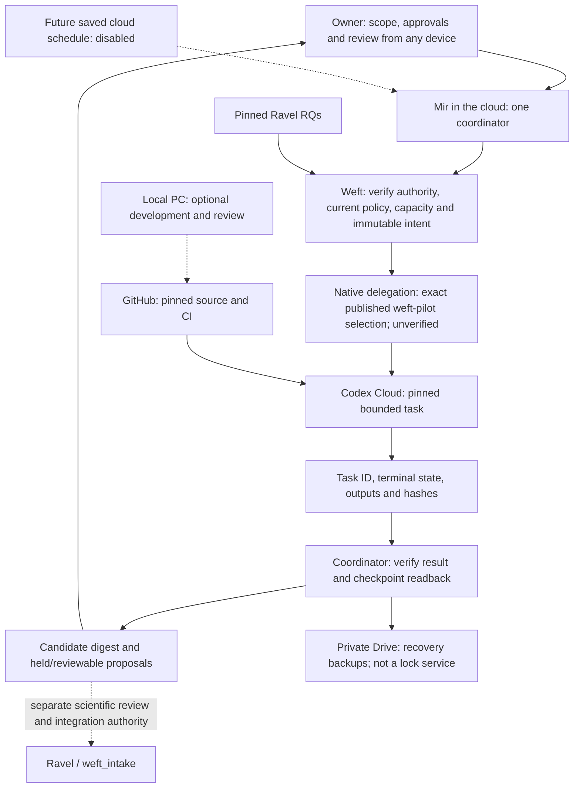

# Remote automation architecture and qualification sequence

Status: **13 October 2026 — one native task admitted/recovered; L1 partial, runtime preflight held**.
This refines M3b and M6 in the [roadmap](IMPLEMENTATION_PLAN.md). It creates no
new scientific gate, deployment, schedule or authority to rerun an attempt.

## Recommended route

Use **Mir's native cloud delegation → the existing `weft-pilot` environment** as
the first route to qualify. Keep the CLI optional. Official documentation says a
dot can work with the user's devices off and start coding threads in an existing
Codex cloud environment. This establishes product capability, not availability
or permission in Mir's current session. [Dot computers and apps](https://learn.chatgpt.com/docs/dots/computers-and-apps).

The current local CLI has a verified AI-host identity but exposes no named cloud
environments and cannot read the known durable task. Its mapping problem need not
become a prerequisite for native delegation. Neither an empty listing nor a
successful existing-task read qualifies a new-task launcher.

The owner has now relayed the [Mir capability report and root
reconciliation](qualification/NATIVE_LAUNCH_INTERFACE.md). Mir reports a native
saved-environment selector and the intended repository; the full reported version
matches the preserved manual worker receipt. Owner screenshots show the configured
network preset and three approved hosts. The owner now confirms same-workspace
picker availability and repeated manual use; account scope remains owner-attested,
not independently authenticated by root. The root tool set does not expose that
launcher; Mir's capabilities do not transfer to this local task.

### Proposed operation with the PC off

All arrows below are the target design, not a claim of deployed automation.

Fully remote means triggering, execution, result retrieval, backup and recovery
can operate without local paths, local credentials or a desktop relay. It does
not remove scientific review or require automatic Ravel merges. Native delegation
must be independently permitted; it must not be used to perform denied browser
actions or route around the B4 hold.

## Architecture comparison

| Route | PC-off potential | Current evidence and decision |
|---|---|---|
| Native Mir → existing Codex Cloud | Documented product capability | Mir reports the selector/target; root checked version continuity and owner settings screenshots. One native child admitted and HOLD artifacts recovered; runtime-status access, exact prompt-byte reconciliation, independent AI-host identity and durable ownership remain unqualified |
| Local `codex cloud` adapter | Requires its invocation host to be online | Optional compatibility track. Running it locally does not meet the PC-off requirement; a remote installation/authentication would need separate qualification |
| Hosted controller → Agents API → hosted sandbox | Documented programmatic components; account access untested | Contingency requiring a new deployment/billing decision, API credentials, controller hosting and durable state. Not connected or selected |

For the contingency, the [Agents API](https://developers.openai.com/api/docs/guides/agents-api/overview)
manages agent sessions. Its [hosted sandbox](https://developers.openai.com/api/docs/guides/agents-api/environments/openai-hosted)
provides remote execution, and [session webhooks](https://developers.openai.com/api/docs/guides/agents-api/sessions/webhooks)
provide notifications that a controller must verify and reconcile with current
session state. A proposed controller would persist unique intents in a
transactional database, admit one job, submit through the documented API, verify
results, and preserve artifacts independently of sandbox lifetime.

This is a different execution service, not an alternate ID for `weft-pilot`.
It requires new resource/network qualification and API billing review; existing
ChatGPT login and subscription are not assumed to authorize or fund it. No cloud
vendor, API project, scheduler or database is provisioned by this plan. The same
scientific and platform holds apply to every route.

## Technical stages within the existing roadmap

L0–L4 are implementation slices, not replacements for M0–M6 or B1–B5.

| Slice | Current status | Work and exit evidence |
|---|---|---|
| L0 — native route and identity | **Owner observations complete; runtime qualification pending** | Selector/repository, version continuity and configured settings observed; owner confirms same-workspace availability. Preserve owner attribution; recheck the live target before submission and actual enforcement after admission |
| L1 — one native synthetic launch | **Partial; runtime preflight HOLD** | [Outcome](qualification/NATIVE_RUNTIME_HOLD.md): one admission and recovered HOLD receipt/log; zero of 12 fixtures invoked. Same-child diagnosis completed: no status tool/skill exposed; platform review pending. Retained create bytes match the freeze; child representation lacks final LF. Preserve the completed manual 18-fixture result separately |
| L2 — remote continuity and recovery | **Partial controls; integration unqualified** | Qualify one authoritative writer, job admission, lost acknowledgement, cancellation, usage interruption, checkpoint readback, inactive restore and resumption of the same task. Demonstrate no required PC callback |
| L3 — bounded search-to-screening operation | **Manual baseline exists; automation unqualified** | Use frozen search/profile/RQ pins, material permissions, source-grounded responses and a reviewable digest. Evaluate B5 on an independently defined sample before claiming quality. B4 remains held; no substitute attempt of its blocked review |
| L4 — prospective recurring operation | **Disabled; owner decision required** | After technical and quality qualification, choose cadence/time zone, scope, finite usage ceilings, notification and stop rules, and permitted artifact destinations. Verify the saved schedule and first bounded cycle |

### L0: inspect before designing an adapter

The capability report must distinguish product documentation, runtime schema,
read-only service observations and unknowns. A tool name or a self-reported claim
is insufficient. Obtain the actual input fields for environment selection,
returning a task identity, reading status/results and cancellation if available.
Verify the account independently for each external service. Do not publish
private identifiers, session paths or raw capability receipts.

No launch is allowed merely to discover the environment. If the only route
requires blocked browser access, an unknown environment ID, a local computer,
new login/access or an unsupported endpoint, record that precise dependency and
stop. Continue support troubleshooting as a separate track; do not assume a CLI
upgrade fixes durable-environment compatibility.

### L1: attach the observed interface to existing controls

Reuse the [offline launch journal](LAUNCH_INTENT_RECOVERY.md), currently in
[PR #11](https://github.com/xorca0711/weft/pull/11), and the existing synthetic
fixtures. Root reviewed the exact PR head for the isolated synthetic trial;
merge/integration remains separate from this qualification. Review/integrate the
dependency before production deployment. The journal does not itself submit,
authenticate a receipt, or enforce remote exclusivity.

A future adapter must expose four observable operations: inspect the intended
target, submit the exact packet once, read the acknowledged task, and retrieve
its result. Map these to observed supported calls; do not invent a dot SDK.
Cancellation remains an explicit capability with a test, not a presumed method.

Record a new, separately scoped qualification occurrence. Pin the reviewed source,
exact prompt, environment/policy/account observations, synthetic limits and output
contract. Current planning supplies no fabricated hashes or task IDs. Commit the
begin record before submission; any missing or ambiguous response holds the same
occurrence. Never mint another key or switch launcher to escape uncertainty.

### L2: distinguish remote execution from durable automation

The existing single-journal guard and manual Drive restores are useful evidence,
but neither prevents a second coordinator from using another database. Before
unattended operation, establish a supported exclusive coordinator lifecycle or
an enforced lease/fencing mechanism. If neither is available, remain manually
coordinated and bring a concrete state-service decision to the owner.

Google Drive remains backup and recovery storage, not a queue, transaction lock
or scheduler. Existing exact-payload export approvals do not authorize arbitrary
future archives. Inventory a bounded recurring artifact class/destination for
owner approval before L4; retain hashes, privacy checks and verification per
payload. Respect any actual tool approval requirement.

Simulate duplicate requests, lost acknowledgements, quota interruption, incomplete
export and cancelled work on synthetic state. Assert at most one submission for
the occurrence, no unverified success, no silent reassignment and no activated
restore copy. A real failure after submission must preserve the original task.
Observe resource/usage limits or mark them unavailable; instructions and account
percentages are not enforceable dollar budgets.

The documented [Codex Cloud VM recovery window](https://learn.chatgpt.com/docs/environments/cloud-environments)
is limited and is not an archival or coordinator-lock guarantee. Keep checkpoint
and result recovery outside the worker lifetime. Qualify PC-off invocation and
reconciliation only after inspecting actual dependencies; the current local
orchestrator cannot test its own operation with its host off.

### L3–L4: quality and operation

Preserve the [decision buffer](DECISION_BUFFER.md), separate data/RQ proposals,
source coverage and scientific authority. A discovery match never directly
becomes accepted Ravel evidence. Freeze B5 sample/reviewer/labels/criteria before
evaluation. Successful scheduling cannot establish reading accuracy or analysis
eligibility. The held B4 task remains under platform review, with its final state
unverified; this architecture supplies no continuation around that hold.

Recurring work needs a saved schedule with scope, time zone and notification
rules; merely connecting a service does not activate monitoring. Verify the
actual saved configuration when separately authorized. [Dot tasks and memory](https://learn.chatgpt.com/docs/dots/tasks-and-memory).

## Immediate handoff and stop condition

The [completion review](ROADMAP_COMPLETION_REVIEW_20261013.md) records additional
local journal controls and offline evaluation tooling. A newly authorized
same-child status-only recheck still reports no runtime-status tool/skill; the
B4 status-only retry was again platform-rejected. No further retry or alternate
route is justified by these results. Preserve both existing occurrences.

The [Mir capability check](qualification/MIR_LAUNCH_CAPABILITY_CHECK.md) returned
a schema/catalog report; see the [interface mapping](qualification/NATIVE_LAUNCH_INTERFACE.md).
The owner confirms same-workspace availability; the network-setting screenshots
are complete. The [frozen native trial](qualification/NATIVE_SYNTHETIC_TRIAL.md)
was submitted once by Mir; the child held before source retrieval or tests.
The [current diagnosis](qualification/NATIVE_RUNTIME_HOLD.md) records recovered
artifacts, missing runtime-status capability and one prompt terminal-LF discrepancy.
The single same-child diagnostic completed and reported no runtime tool/skill
exposure. The support packet is updated, unsent; no further turn is needed without
new evidence. Account scope remains owner-attested. Preserve the existing
occurrence; no replacement or test restart.

Choi remains complete and preserved. No old ledger, worker, analysis output or
source snapshot is changed. M6 stays disabled. These documentation changes add
no runtime enforcement and do not change any scientific gate or acceptance rule.
