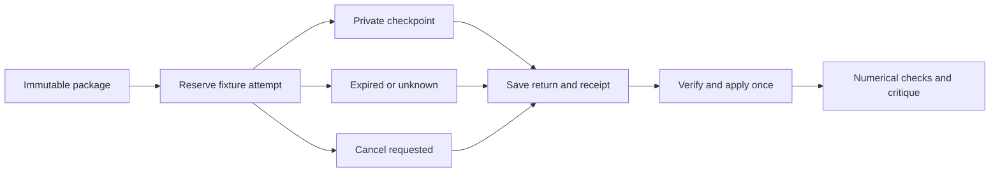

# Scientific packages, fixture recovery and evidence review

This is the implemented offline part of W04–W07 and W09. It prepares real or
synthetic contracts, but **only explicitly synthetic cases can enter replay**.
Replay imports controlled output fixtures; it never executes supplied analysis
code. A completed replay is not a scientific run, a verified worker termination,
runtime qualification, accepted result or permission to dispatch. Ravel is
unchanged. Live author-code isolation and worker integration remain open.

The implementation is [science_adapter.py](../weft/science_adapter.py) and
[science_review.py](../weft/science_review.py). They extend the
[workspace record contract](EVIDENCE_WORKSPACE.md), using the same immutable
references and actor attestations. [Pipeline tests](../tests/test_science_pipeline.py)
exercise failure and recovery as well as the happy path. The
[roadmap](EVIDENCE_GENERATION_ROADMAP.md) distinguishes these software deliveries
from each phase's remaining real-run completion evidence.

## Commands

`--root` is the absolute private workspace established with `evidence-init`.
Every `--*-reference` file contains the exact four-field reference object
returned by the earlier command, not the whole command result. Checkpoints
contain private lease tokens; keep them local. Example paths below are placeholders.

```powershell
python -m weft evidence-import --root X:/WeftEvidence/workspace-v1 --record private/numerical-plan.json
python -m weft evidence-package --root X:/WeftEvidence/workspace-v1 --contract-reference private/contract-ref.json --plan-reference private/checks-ref.json
python -m weft evidence-fixture-begin --root X:/WeftEvidence/workspace-v1 --package-reference private/package-ref.json
python -m weft evidence-fixture-return --root X:/WeftEvidence/workspace-v1 --checkpoint private/checkpoint.json --directory private/return --expected-manifest-sha256 <separately-retained-hash>
python -m weft evidence-fixture-recover --root X:/WeftEvidence/workspace-v1 --checkpoint private/checkpoint.json --receipt-reference private/receipt-ref.json
python -m weft evidence-status --root X:/WeftEvidence/workspace-v1
python -m weft evidence-qc --root X:/WeftEvidence/workspace-v1 --receipt-reference private/receipt-ref.json
python -m weft evidence-import --root X:/WeftEvidence/workspace-v1 --record private/critique.json
python -m weft evidence-view --root X:/WeftEvidence/workspace-v1 --receipt-reference private/receipt-ref.json --review-reference private/review-ref.json
python -m weft evidence-dry-export --root X:/WeftEvidence/workspace-v1 --receipt-reference private/receipt-ref.json --review-reference private/review-ref.json --proposed-use "Review provisional evidence"
python -m weft evidence-export-verify --root X:/WeftEvidence/workspace-v1 --export private/export.json --expected-sha256 <separately-retained-hash>
python -m weft evidence-readiness --root X:/WeftEvidence/workspace-v1 --contract-reference private/contract-ref.json
```

`evidence-fixture-cancel --root ... --job ...` requests cancellation.
`evidence-fixture-expire --root ...` records expired leases as unknown.
Neither operation terminates a process or releases an unresolved slot.
QC discrepancies and readiness holds exit with code 2; malformed records exit 1.
An operationally completed fixture can still have QC discrepancies.

To generate a complete, clearly labelled example without data or a worker:

```powershell
python tests/evidence_demo.py --directory C:/path/to/new-weft-fixture
```

The parent must exist; the destination must be new. This creates synthetic
input/source/protected directories, a workspace, one controlled fixture return,
an issue-linked critique, HTML and a private dry proposal. It deliberately keeps
a numerical discrepancy and records no owner disposition. It uses test fixture
builders; it is not a production scientific runner.

## Pinned packages and one ledger

`packages/<sha256>.json` binds the contract, numerical plan and exact dependency
closure: case/source/feasibility records, retained sources, inputs, code,
environment and supplied design-review evidence. It pins implementation hashes
for the adapter, workspace, scientific checks, review code and job ledger.
Admission and recovery recheck the closure and latest revisions. Changed code,
inputs, source versions, contracts or check plans hold old packages. Retain their
files; do not rewrite or silently rescore them. Interpretation remains bounded
by the frozen contract. Package preparation grants no execution authority.

The workspace's `control/jobs.sqlite` is the single authoritative local ledger
for its controlled replays and synthetic jobs. It uses the existing
`JobLedger.jobs`, `attempts` and append-only `events` tables, rather than a second
scientific status database. Both kinds reserve the same single slot. Existing
synthetic dispatch/reconciliation APIs explicitly reject the new replay packet
kind; no synthetic validator has been relaxed. This is per-workspace local
coordination, not a remote service or global lock across arbitrary workspaces.

Replay lifecycle:



No arrow launches a process. `fixture_completed`, `fixture_failed` and
`fixture_cancelled` describe controlled fixture intake. Failed/cancelled attempts
consume their budget. A separately requested next replay uses a fresh directory,
up to the contract's limit and an offline maximum of three. Completed replays do
not restart. Unknown states retain their slot, including across process restart.

Private checkpoints and outputs live at
`runs/<job-sha256>/attempt-<six-digit-id>/`. A checkpoint is saved during reservation;
a directory left by a failed/rolled-back reservation prevents reuse and requires
investigation. Output files and return/receipt bytes are saved before applying
the terminal ledger event. Interrupted complete-file transfers resume only if
existing bytes match. A partial file is preserved and causes a hold; it cannot
be overwritten by retry. Recovery is idempotent after terminal application.
`evidence-status` reads attempts and receipt references without lease tokens.
Copied workspaces stay inactive; there is no activation or lease-stealing API.

## Return contract

`return.json` has exactly: `schema_version: weft-science-adapter-v1`,
`kind: synthetic-fixture-return`, `job_id`, `attempt_id`, `package_sha256`,
`outcome: completed|failed|cancelled`, `files`, `error`.
Each file has exactly `path`, `sha256`, `bytes`; its path must be a planned
`outputs/` path. Completed returns include every planned output and `error: null`.
Failed/cancelled returns may retain a subset and require an error description.
Unexpected files are never copied. Each retained artifact is at most 1 MiB;
output total is at most 8 MiB and cannot exceed the frozen disk bound. These are
offline transport bounds, not enforced worker memory, network or usage limits.

The expected manifest hash comes from a separately retained delivery record.
Matching hashes detect byte drift, not a worker's identity or process termination.
Receipt and output references bind the exact attempt and package. Malformed
measurements are retained as returned evidence but cannot pass numerical QC.

## Additional immutable records

All three kinds add the common fields from the workspace guide, including
`article_id`, `case_id` and false dispatch/acceptance flags. They have separate
contiguous revision chains under the case directory.

**numerical-plan** adds `contract`, `checks`, `limitations`. Each check has exactly:

| Field | Meaning |
|---|---|
| `id`, `output`, `metric` | Unique check, planned QC output and unique metric in it |
| `quantity` | `scalar` or `proportion`; additional measures need a versioned adapter |
| `expected` | Supplied reference quantity or null when no numerical target is justified |
| `absolute_tolerance`, `relative_tolerance` | Nonnegative supplied bounds; both null without a target |
| `arithmetic_tolerance` | Supplied nonnegative tolerance for proportion arithmetic |
| `denominator` | Explicit positive integer; kept distinct from biological-unit count |
| `units` | Distinct IDs already present in the feasibility map |
| `reference` | Retained resource ID, locator and source hash; null without a target |
| `interval_required` | Explicit boolean; does not invent a confidence level |
| `sensitivity_labels` | The pre-specified sensitivity outputs to retain |

Targets/tolerances are supplied and frozen before reservation. The validator does
not invent margins, authenticate source interpretation or establish adequate
replication. The plan must retain all contract interpretation limits.

QC files use `schema_version: weft-measurements-v1` and `metrics`. Each metric has
`id`, finite `value`, nullable `numerator`, positive integer `denominator`,
distinct `unit_ids`, nullable `[lower, upper]` `interval`, and `sensitivity`
entries containing `label` and finite `value`. A proportion has an integer
numerator between zero and its denominator; a scalar has a null numerator.
QC compares unit IDs and denominators, checks proportion arithmetic, required
intervals and sensitivity coverage, and reports reference discrepancy when
`abs(observed - expected) > absolute_tolerance + relative_tolerance * abs(expected)`.
No target means no reference-comparison verdict. An interval is checked for
structure/order, not statistical coverage. Sensitivity values are retained for
critique, not automatically judged scientifically adequate.

**scientific-review** adds `receipt`, `issues`, `responses`, `interpretation`.
Each issue has `id`, nullable frozen `check_id`, `severity` (`blocking`,
`limitation`, `note`), `comment`, and `evidence` references to returned outputs.
Responses contain `issue_id`, `response`, and retained `evidence` references.
No response silently closes/deletes an issue. Revisions preserve the earlier
critique, including unresolved defects, alternative explanations and nulls.
Actor identity and inspection remain self-reported; an AI critic is not an
independent scientific reference.

**owner-disposition** adds `receipt`, `review`, `disposition`, `rationale` and
`decision_evidence`. It requires a supplied human actor and retained decision
evidence; this is still an attestation, not identity authentication. Allowed
values: `reading-only`, `infeasible`, `deferred`, `no-further-analysis`,
`review-requested`, `next-comparison-proposed`, `export-proposed`. There is no
canonical acceptance value. Missing owner input remains absent in the view;
software must never create an owner response to finish a phase.

## Private evidence view and optional handoff

The immutable HTML view connects the question, methods, verified quantities,
reference discrepancies, unit/denominator accounting, uncertainty, sensitivity,
figures, critique and any actually supplied disposition. It draws simple plots
from verified fixture quantities. Returned PNG/JPEG figures can be embedded;
author HTML/SVG is never executed. All supplied text is escaped, and the view's
content security policy disables scripts and external resources. It is local,
private and bounded to 1 MiB; large figures need a smaller reviewed derivative.

The W09 dry proposal includes allowlisted scientific metadata, quantitative QC,
critique/response text, proposed use and lineage hashes. It omits raw source/data
files, filesystem bindings, lease tokens and sample IDs. Supplied free text still
requires privacy/content review before transfer. Verification checks exact bytes
and the proposal boundary; it does not establish scientific correctness. No
Ravel destination, canonical ID or owner acceptance is created. Actual transfer
still needs authorized scope, current Ravel base review and a merge receipt.

## Remaining live gates

The [W08 unblock plan](qualification/W08_RUNTIME_UNBLOCK.md) now maps each gate
to concrete evidence, a read-only author-isolation control auditor and a focused
platform support request. It distinguishes historical container checks from
current runtime qualification, and output quota/watchdog enforcement from receipt
size bounds. No live dispatcher is supplied by that auditor.

`evidence-readiness` reports the unresolved work rather than creating an attempt:
author-code isolation and permitted runtime qualification (W04/W10), actual worker
return integration (W05), a fresh real case and scientific disposition (W08),
remote ownership/fencing/cancellation/usage and PC-independent recovery (W11),
then separately configured optional recurrence (W12). Software fixture tests do
not satisfy those exits. No held cloud occurrence is retried or replaced by
these commands, and no schedule, paid service or external privilege is enabled.
